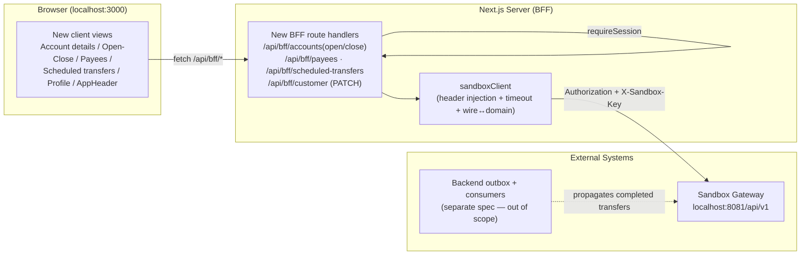

# Design Document

## Overview

This spec adds the **client-side realism layer** to the Banking_App — the dedicated account details view, account open/close, saved payees, scheduled and recurring transfers, a profile page, correct balance/statement freshness with manual refresh, and a shared navigation header plus a shared currency formatter. It is a sibling of the `customer-banking-app` (v1) spec and extends that foundation; it does not restate or change anything v1 already covers (OIDC authentication, the Dashboard, Statement_View, Transfer_Form, the BFF_Layer, configuration, resilience, repository setup, CI, and the v1 test suite). The v1 design remains authoritative for the architecture this one inherits.

The Banking_App stays a **pure HTTP client** of the independently deployed RP Digital Bank Sandbox. It implements no banking business logic and holds no ledger state. Every new piece of banking data (an account's details, a saved payee, a scheduled transfer, a profile update) originates from the Sandbox_Gateway and is only presented by this application.

### Security posture is preserved without exception (BFF)

The central v1 decision is unchanged: **the browser never possesses the OIDC access token or the Sandbox_Key**. Both secrets are attached to every upstream call from server-side Next.js route handlers (the BFF_Layer), inside the single shared `lib/server/sandboxClient.ts` choke point. Every new data need this spec introduces is served by a new same-origin `/api/bff/*` route backed by a new `sandboxClient` function; the Browser_Client MUST NOT call the Sandbox_Gateway directly. This invariant continues to be guarded by the existing static source scan (v1 Property 5), which this spec's new client views and modules must satisfy, and is reaffirmed below as this spec's Property 5.

Every new mutating route reuses the existing BFF plumbing — `requireSession`, `errorResponse`, `respondFromResult`, and `respondFromTransferResult` from `app/api/bff/_lib/respond.ts` — so credential confinement, the "forward only `status` + `error`" rule, and the "require a session before any outbound call" guard are inherited rather than reimplemented.

### Relationship to the backend outbox propagation (external, out of scope)

The superseding freshness behavior in Requirement 1 depends on a **companion backend specification** (a separate repository) that propagates completed Transfers from the payment ledger to the account service via a transactional outbox and scheduled consumers. That mechanism is **out of scope for this client spec**: the Banking_App only consumes the corrected sandbox data and presents it, and it never implements, triggers, or verifies the propagation. The propagation delay is treated as an external timing characteristic; the client's answer to it is a **Manual_Refresh** affordance on the Dashboard and Statement_View that re-fetches current data on demand. The client therefore makes no freshness guarantee beyond "display exactly what the latest successful read returned."

### Defensive consumption of not-yet-built backend endpoints

Several new capabilities (account open/close, saved payees, scheduled transfers, profile update) rely on Sandbox_Gateway endpoints whose contract is owned by the backend spec and which may not yet exist at the time this client is built. The design consumes them **defensively**: the assumed upstream paths are stated as ASSUMPTIONS (see Architecture) to be confirmed against the backend contract; each new view degrades gracefully through the inherited loading/empty/error state machine when its endpoint is missing, slow, or erroring (a `404`/`5xx` surfaces the same retryable error region as any other failure rather than crashing). Every new capability is verified entirely with **mocked sandbox responses** (MSW / `fetch` mocks), so correctness and every failure mode are testable without the live sandbox or a finished backend.

### Scope

In scope: Account_Details_View; Account_Management (open/close); Transaction history presentation improvements (direction, counterparty, running balance, propagated transfer entries); Saved_Payees and the Payee_Picker; Scheduled_Transfers (create/list/cancel, recurrence, executed-outcome mapping); Profile_Page with optional edit; the shared AppHeader; the shared Currency_Formatter; Manual_Refresh on Dashboard and Statement_View; the new BFF routes and `sandboxClient` functions; and the test suite driven by mocked sandbox responses.

Out of scope: the backend outbox/propagation mechanism; any banking business logic (balances, AML rules, ledger posting, ownership enforcement) — all owned by the sandbox; and anything v1 already delivered.

## Architecture

### Layered request flow (unchanged)

The layered flow is identical to v1; new routes slot into the same pipeline and reuse the same choke point.

```
Browser (React Server + Client Components)
    │  (same-origin fetch to /api/bff/*, cookie-based session)
    ▼
Next.js Route Handlers  ── the BFF proxy layer (server-only)
    │  requireSession() → reads access token from session + X-Sandbox-Key from env
    │  injects Authorization + X-Sandbox-Key + Content-Type; applies timeout
    ▼
lib/server/sandboxClient.ts  ── the single outbound choke point
    │  sandboxFetch<T>() / createTransfer() : header injection, timeout, normalize
    ▼
Sandbox Gateway  http://localhost:8081/api/v1
    ▼
RP Digital Bank Sandbox (external, independent)  ← backend outbox propagation lives here
```



### Route table (browser route → upstream sandbox call → notes)

New BFF routes map 1:1 to new sandbox endpoints and are thin wrappers that call one `sandboxClient` function and shape the response via the shared `respond.ts` helpers. The existing read routes are reused unchanged by the new views.

| BFF route (browser calls this) | Upstream sandbox call | Requirement | Notes |
|--------------------------------|-----------------------|-------------|-------|
| `POST /api/bff/accounts` | `POST /accounts` *(ASSUMED)* | 3.1–3.3 | Open account; body `{ type, currency }`; 201 success → available on next `GET /accounts` |
| `POST /api/bff/accounts/[accountNumber]/close` | `POST /accounts/{n}/close` *(ASSUMED; may be `DELETE /accounts/{n}`)* | 3.5–3.6, 3.9 | Close account; 409 business conflict (non-zero balance / already closed) |
| `GET /api/bff/payees` | `GET /payees` *(ASSUMED)* | 5.4–5.5 | List saved payees |
| `POST /api/bff/payees` | `POST /payees` *(ASSUMED)* | 5.1–5.3 | Create payee; body `{ label, destinationAccount }` |
| `DELETE /api/bff/payees/[payeeId]` | `DELETE /payees/{id}` *(ASSUMED)* | 5.7 | Delete payee |
| `GET /api/bff/scheduled-transfers` | `GET /payments/scheduled-transfers` *(ASSUMED)* | 6.5, 6.7 | List scheduled transfers with status |
| `POST /api/bff/scheduled-transfers` | `POST /payments/scheduled-transfers` *(ASSUMED)* | 6.1, 6.4 | Create scheduled/recurring transfer |
| `POST /api/bff/scheduled-transfers/[id]/cancel` | `POST /payments/scheduled-transfers/{id}/cancel` *(ASSUMED; may be `DELETE`)* | 6.6, 6.12 | Cancel a SCHEDULED transfer; 409 if already executed/cancelled |
| `PATCH /api/bff/customer` | `PATCH /customers/me` *(ASSUMED)* | 7.8–7.13 | Update profile (only where the gateway supports edits) |
| `GET /api/bff/customer` | `GET /customers/me` | 7.1 | **Reused from v1** by the Profile_Page |
| `GET /api/bff/accounts` | `GET /accounts` | 1.1–1.2, 3.3, 3.6 | **Reused from v1** by the Dashboard + Manual_Refresh |
| `GET /api/bff/accounts/[accountNumber]` | `GET /accounts/{accountNumber}` | 2.1 | **Reused from v1** by the Account_Details_View |
| `GET /api/bff/accounts/[accountNumber]/transactions` | `GET /transactions/accounts/{accountNumber}` | 4.1–4.10 | **Reused from v1** by the Statement_View + Manual_Refresh |

> **ASSUMPTIONS — must be confirmed against the backend contract.** The upstream paths and verbs marked *(ASSUMED)* above — `POST /accounts`, `POST /accounts/{n}/close` (or `DELETE /accounts/{n}`), `GET/POST /payees`, `DELETE /payees/{id}`, `GET/POST /payments/scheduled-transfers`, `POST /payments/scheduled-transfers/{id}/cancel` (or `DELETE`), and `PATCH /customers/me` — are **not yet confirmed**. They are assumed to align with the companion backend spec and MUST be reconciled with that contract before integration. Because each assumed path is reached only through its `sandboxClient` function, confirming or correcting a path is a one-line change in that function; the BFF routes, views, validation, and tests (which mock the `sandboxClient`/BFF boundary) are unaffected. Where an endpoint does not yet exist, its view degrades gracefully (Requirement 10) and is exercised against mocked responses (Requirement 12).

### Credential confinement on the new routes (Requirement 9)

Every new route is subject to the same posture as v1, inherited verbatim from `sandboxClient` + `respond.ts`:

- `sandboxFetch` / the transfer path attach `Authorization: Bearer <token>` and `X-Sandbox-Key: <key>` server-side (Requirement 9.1) and resolve both strictly server-side; neither can be overridden by the caller because `buildHeaders` applies caller headers first and then force-sets the credentials.
- A **client-supplied** `Authorization` or `X-Sandbox-Key` header on the inbound browser request is ignored: the BFF never reads request headers for credentials; it always resolves the server-side token/key and injects those (Requirement 9.6).
- If either credential is missing server-side, no outbound call is made and an unauthenticated response is returned (Requirement 9.3), reusing `sandboxFetch`'s `UNAUTHENTICATED` result and `requireSession`'s 401.
- Only `status` + the machine-readable `error` code (plus a non-secret `message` for transfer-style 409s) are forwarded; the raw upstream headers, token, and key never reach the browser (Requirements 9.2, 9.4, 9.5, 9.7).

### Configuration (Requirement 11)

New routes resolve the Sandbox_Gateway base URL and Sandbox_Key from `getConfig()` exactly as v1 does; no literal gateway/issuer URLs or key values appear in any source this spec adds (Requirements 11.1, 11.2). This spec adds **no new required environment variable** — every new route targets the same gateway base URL under additional paths. If a future need introduces a new required value, it is documented in the environment example file with a placeholder and included in the existing fail-fast startup validation that aborts and names any missing/empty value (Requirements 11.3, 11.4).

## Components and Interfaces

All new pages render the shared **AppHeader** (navigation + logout) while authenticated (Requirement 8.1, 8.2), reuse the shared `LoadingState` / `EmptyState` / `ErrorState` / `TransferResultBanner` components, and follow the canonical per-region `RegionState` pattern from `DashboardClient`/`StatementClient`: each data region is `loading | ok | empty | error`, a loading state renders from first paint (satisfying the 300/500 ms bounds with no artificial delay), a 401 routes to re-authentication **once** per mount via a shared guard, and a 429 surfaces a rate-limit message with the retry control disabled. Every displayed amount goes through the shared **Currency_Formatter** (Requirement 8.5), replacing the duplicated `formatCurrency` helpers currently inlined in `DashboardClient` and `StatementClient`.

### Shared utilities and layout

**`Currency_Formatter`** — `lib/currency.ts` (pure, framework-free, safe for server + client). Extracted from the two duplicated `formatCurrency` helpers and hardened for Requirement 8.6–8.8.

```typescript
/** Fixed placeholder shown when the amount is not a finite number (Requirement 8.7). */
export const AMOUNT_PLACEHOLDER = '—';

/**
 * Format a numeric amount + ISO-4217 currency code into a stable display string.
 * - Deterministic: a FIXED locale is used (never the host locale) so the same
 *   (amount, currency) renders character-for-character identically everywhere
 *   and on every invocation (Requirement 8.6).
 * - Total: never throws. A null/undefined/non-finite amount returns the fixed
 *   placeholder (8.7); an empty/invalid currency code renders the numeric
 *   amount with the code shown verbatim as the indicator (8.8).
 */
export function formatCurrency(amount: number | null | undefined, currency: string): string;
```

**`AppHeader`** — `app/components/AppHeader.tsx` (client component). Renders navigation links to the Dashboard, Statement_View (via the account list), Account_Details_View, Transfer_Form, Profile_Page, Account_Management views, and Scheduled_Transfer views, plus the existing `LogoutButton` (Requirement 8.1, 8.3). It is rendered by every authenticated page (the new pages and, by extension, the existing ones) so navigation is consistent (Requirement 8.2).

```typescript
export interface AppHeaderProps {
  /** Marks the active destination for `aria-current` styling. */
  active?: 'dashboard' | 'transfer' | 'profile' | 'accounts' | 'payees' | 'scheduled';
}
export function AppHeader(props: AppHeaderProps): JSX.Element;
```

### New `sandboxClient` functions

New outbound functions live alongside the existing ones in `lib/server/sandboxClient.ts`, each routed through `sandboxFetch` (reads/mutations) with a wire↔domain mapper, mirroring the v1 signatures and the `deps` injection seam used for testing.

```typescript
// --- Account management (Requirement 3) ---
export async function createAccount(
  body: OpenAccountRequest, deps?: SandboxDeps,
): Promise<SandboxResult<Account>>;               // POST /accounts (ASSUMED)

export async function closeAccount(
  accountNumber: string, deps?: SandboxDeps,
): Promise<SandboxResult<Account>>;               // POST /accounts/{n}/close (ASSUMED)

// --- Saved payees (Requirement 5) ---
export async function listPayees(deps?: SandboxDeps): Promise<SandboxResult<Payee[]>>;
export async function createPayee(
  body: CreatePayeeRequest, deps?: SandboxDeps,
): Promise<SandboxResult<Payee>>;                  // POST /payees (ASSUMED)
export async function deletePayee(
  payeeId: string, deps?: SandboxDeps,
): Promise<SandboxResult<void>>;                   // DELETE /payees/{id} (ASSUMED)

// --- Scheduled transfers (Requirement 6) ---
export async function listScheduledTransfers(
  deps?: SandboxDeps,
): Promise<SandboxResult<ScheduledTransfer[]>>;    // GET /payments/scheduled-transfers (ASSUMED)
export async function createScheduledTransfer(
  body: ScheduledTransferRequest, deps?: SandboxDeps,
): Promise<SandboxResult<ScheduledTransfer>>;      // POST ... (ASSUMED)
export async function cancelScheduledTransfer(
  id: string, deps?: SandboxDeps,
): Promise<SandboxResult<ScheduledTransfer>>;      // POST .../{id}/cancel (ASSUMED)

// --- Profile update (Requirement 7, only where supported) ---
export async function updateCustomer(
  body: CustomerProfileUpdate, deps?: SandboxDeps,
): Promise<SandboxResult<Customer>>;               // PATCH /customers/me (ASSUMED)
```

Each function encodes path segments with `encodeURIComponent` (as `getAccount`/`getTransactions` already do), threads `deps` through for testability, and maps the wire shape to the domain type via a defensive mapper (`mapAccount`, `mapPayee`, `mapScheduledTransfer`, `mapCustomer`) that tolerates missing/renamed fields and never throws.

### New BFF route handlers

Each handler mirrors `app/api/bff/transfers/route.ts`: `export const dynamic = 'force-dynamic'`, `runtime = 'nodejs'`, `requireSession()` first, server-side body validation for mutations (defence-in-depth, kept in sync with the shared client validation), then delegate to one `sandboxClient` function and shape the response via `respondFromResult` (reads and generic mutations) or `respondFromTransferResult` (scheduled-transfer executed outcomes).

```typescript
// app/api/bff/payees/route.ts
export async function GET(): Promise<NextResponse>;           // list → respondFromResult
export async function POST(req: Request): Promise<NextResponse>; // validate → createPayee → respondFromResult

// app/api/bff/payees/[payeeId]/route.ts
export async function DELETE(                                  // deletePayee → respondFromResult
  req: Request, ctx: { params: { payeeId: string } },
): Promise<NextResponse>;

// app/api/bff/accounts/route.ts  → add POST (open account)
export async function POST(req: Request): Promise<NextResponse>; // validate → createAccount

// app/api/bff/accounts/[accountNumber]/close/route.ts
export async function POST(                                    // closeAccount → respondFromResult
  req: Request, ctx: { params: { accountNumber: string } },
): Promise<NextResponse>;

// app/api/bff/scheduled-transfers/route.ts
export async function GET(): Promise<NextResponse>;
export async function POST(req: Request): Promise<NextResponse>; // validate (transferValidation + schedule date) → create

// app/api/bff/scheduled-transfers/[id]/cancel/route.ts
export async function POST(
  req: Request, ctx: { params: { id: string } },
): Promise<NextResponse>;

// app/api/bff/customer/route.ts  → add PATCH (profile update, where supported)
export async function PATCH(req: Request): Promise<NextResponse>;
```

A new helper `respondFromMutationResult(result, { createdStatus })` is added to `_lib/respond.ts` as a thin wrapper over the existing mapping so 201/202 success for mutations is forwarded distinctly while reusing the existing 401/403/409/429/timeout/network/unexpected branches. (For scheduled-transfer *executed* outcomes, `mapTransferOutcome` / `respondFromTransferResult` are reused so AML held/blocked map exactly as the Transfer_Form — Requirement 6.7.)

### New pages and client components

- **Account_Details_View** — `app/accounts/[accountNumber]/details/page.tsx` + `AccountDetailsClient.tsx`. Fetches `GET /api/bff/accounts/[accountNumber]`; renders number, type, Account_Status, currency, and Currency_Formatter balance **read-only** with no mutating control (Requirement 2.2, 2.8); distinct `not-owner` (403) state (2.6), empty state when no account (2.4), 401 re-auth (2.7), 429 rate-limit (2.9), and generic error+retry (2.5).
- **Account_Management** — `app/accounts/open/page.tsx` + `OpenAccountForm.tsx` (type + currency fields, client validation per 3.2, success state per 3.3) and a **close-account confirmation** control on the Account_Details_View / Dashboard (`CloseAccountButton.tsx`) that requires explicit confirmation before any BFF call (3.4, 3.7) and maps 403/409/401/429/generic outcomes (3.8–3.12).
- **Payee_Picker + payee management** — `PayeePicker.tsx` (used on the Transfer_Form: lists saved payees, populates the "To account" field on select per 5.5, 5.6; loading/empty/error per 5.8–5.10) and a payee management surface for create (5.1–5.3) and delete (5.7).
- **Scheduled_Transfer views** — `app/scheduled-transfers/page.tsx` with a create form (source/destination/amount/description via `transferValidation`, schedule date strictly-after-today, recurrence select per 6.1–6.3), a list showing each transfer's Scheduled_Transfer_Status (6.5), a cancel control for SCHEDULED items (6.6, 6.12), and executed-outcome rendering reusing the Transfer_Form outcome mapping (6.7).
- **Profile_Page** — `app/profile/page.tsx` + `ProfileClient.tsx`. Fetches `GET /api/bff/customer` (7.1–7.7); renders fields read-only unless edits are supported, in which case it validates each editable field client-side before `PATCH /api/bff/customer` and shows success/updated or error-retaining outcomes (7.8–7.13).
- **Manual_Refresh** — a small shared `RefreshButton.tsx` wired into the Dashboard and Statement_View that re-invokes the existing region loaders; disabled while in flight and retaining prior data on failure (Requirement 1.4–1.8).

### Extended pure validation (`transferValidation.ts`)

Payee and scheduled-transfer validation is added to `lib/transferValidation.ts` so the exact same rules run on the client and are re-applied server-side in the corresponding BFF routes (Requirements 5.13, 6.2, 12.6). The existing `validateTransferForm` is reused unchanged for the scheduled-transfer money fields.

```typescript
export interface PayeeFormValues { label: string; destinationAccount: string; }
export interface PayeeFormErrors { label?: string; destinationAccount?: string; }
/** 5.2/5.13: non-empty label and non-empty destination account. */
export function validatePayeeForm(values: PayeeFormValues): PayeeFormErrors;

export interface ScheduledTransferFormValues extends TransferFormValues {
  scheduleDate: string;            // ISO 8601 date
  recurrence: Recurrence;
}
export interface ScheduledTransferFormErrors extends TransferFormErrors {
  scheduleDate?: string;
  recurrence?: string;
}
/** 6.2/6.3: reuse transfer rules; require scheduleDate strictly after `now`. */
export function validateScheduledTransferForm(
  values: ScheduledTransferFormValues,
  now: Date,
  ownedAccounts?: ReadonlyArray<Pick<Account, 'accountNumber'>>,
): ScheduledTransferFormErrors;
```

## Data Models

New and extended domain types live in `lib/types.ts` (safe for server + client, no secrets). `Account.status` already exists and carries the Account_Status.

```typescript
// --- Account management ---
/** Body for POST /api/bff/accounts → POST /accounts (Requirement 3.1, 3.2). */
export interface OpenAccountRequest {
  type: AccountType;   // 'SAVINGS' | 'CURRENT' — validated against the accepted set
  currency: string;    // required, non-empty
}

// --- Saved payees (Requirement 5) ---
export interface Payee {
  id: string;                 // backend-assigned identifier (wire: `payeeId`/`id`)
  label: string;              // human-readable label
  destinationAccount: string; // account number to pre-fill "To account"
}
/** Body for POST /api/bff/payees → POST /payees. */
export interface CreatePayeeRequest {
  label: string;
  destinationAccount: string;
}

// --- Scheduled & recurring transfers (Requirement 6) ---
/** Supported recurrence set, including the one-off option (Requirement 6.1). */
export type Recurrence = 'ONCE' | 'DAILY' | 'WEEKLY' | 'MONTHLY';

/** Lifecycle state reported by the gateway (Requirement 6.5). */
export type ScheduledTransferStatus = 'SCHEDULED' | 'EXECUTED' | 'FAILED' | 'CANCELLED';

export interface ScheduledTransfer {
  id: string;                      // wire: `scheduledTransferRef`/`id`
  fromAccount: string;
  toAccount: string;
  amount: number;
  description: string;
  scheduleDate: string;            // ISO 8601 date of next/only execution
  recurrence: Recurrence;
  status: ScheduledTransferStatus;
  /**
   * Present once the transfer has executed through the backend payment path.
   * Projected onto the same outcome surface as the Transfer_Form so AML
   * held/blocked render identically (Requirement 6.7).
   */
  lastOutcome?: TransferOutcomeInput; // { status, error?, message? }
}
/** Body for POST /api/bff/scheduled-transfers → POST /payments/scheduled-transfers. */
export interface ScheduledTransferRequest {
  fromAccount: string;
  toAccount: string;
  amount: number;
  description: string;
  scheduleDate: string;            // ISO 8601 date (strictly after today)
  recurrence: Recurrence;
}

// --- Profile update (Requirement 7, only where supported) ---
/** Partial, client-validated editable fields for PATCH /customers/me. */
export type CustomerProfileUpdate = Partial<Pick<CustomerProfile,
  'phone' | 'addressLine1' | 'addressLine2' | 'city' | 'postalCode' | 'country' | 'occupation' | 'preferredChannel'
>>;
```

The new `sandboxClient` functions return the existing generic `SandboxResult<T>` union; the scheduled-transfer *executed* outcome reuses `TransferResult` / `TransferOutcomeInput` (from `lib/types.ts` / `lib/transferPresentation.ts`) so there is a single source of truth for transfer-outcome presentation.

**Manual_Refresh state handling.** Each refreshable region keeps its existing `RegionState<T>` plus a `refreshing: boolean` flag (distinct from the initial `loading` status). While `refreshing`, the `RefreshButton` is disabled (Requirement 1.6) and the region continues to show its current data; on success the data is replaced and the flag cleared (1.7); on failure or a >10 s timeout the region shows an error with retry, **retains** the prior data, re-enables the button, and never crashes (1.8). This is a single-flight guard analogous to the existing `SubmitGuard` (v1 Property 7) — at most one in-flight refresh per cycle.

## Correctness Properties

*A property is a characteristic or behavior that should hold true across all valid executions of a system — essentially, a formal statement about what the system should do. Properties serve as the bridge between human-readable specifications and machine-verifiable correctness guarantees.*

These properties target the security-, mapping-, validation-, and fidelity-critical logic this spec adds, following the v1 posture: each is implemented as a single property-based test configured for a minimum of 100 iterations and tagged **Feature: banking-app-realism, Property {number}: {property_text}**. Pure UI-state, timing, and per-view flow behaviors are covered by example/integration tests in the Testing Strategy instead. The properties here are complementary to — and do not restate — v1 Properties 1–7; v1 Property 5 (no direct browser-to-gateway calls) and v1 Property 6 (config fail-fast) continue to guard the new code, and this spec's Property 9 extends the former to the new client views.

### Property 1: Read fidelity (display equals the latest response, no client adjustment)

*For any* successful `GET /accounts` response and *for any* successful transactions response, after an initial load or a Manual_Refresh the Banking_App SHALL display exactly the account balances / transaction entries contained in that latest response — a one-to-one correspondence with no derived, adjusted, reconciled, or client-synthesized value — so that whatever the backend has already propagated is reflected and nothing else is.

**Validates: Requirements 1.2, 1.3**

### Property 2: Transaction presentation fidelity

*For any* transaction in the latest transactions response, the Statement_View SHALL render its direction as a debit or a credit matching that transaction's direction, SHALL render its counterparty if and only if the transaction has one (and otherwise omit it without error), and SHALL render its running balance if and only if the transaction includes one.

**Validates: Requirements 4.1, 4.2, 4.3**

### Property 3: Validation soundness and client/server parity

*For any* open-account input, Saved_Payee input, Scheduled_Transfer input (including its schedule date), editable-profile input, or Statement date range: *if* the input violates a validation rule — a missing/unaccepted account type or missing currency; an empty payee label or empty destination account; a transfer field rejected by `transferValidation` (empty/equal accounts, amount empty / ≤ 0 / > 999,999,999.99 / non-numeric / > 2 decimals, description > 140 chars); a schedule date not strictly after the current date; an invalid editable-profile field; or a date range where `from` is later than `to` — *then* the Banking_App SHALL surface a field-level error and SHALL NOT send the request (retaining any previously entered values / loaded data); and *if* the input satisfies every rule, the request SHALL be sent. Moreover, *for any* Saved_Payee or Scheduled_Transfer input, the pure client-side `transferValidation` verdict SHALL equal the verdict enforced by the corresponding BFF route (accept and reject the identical inputs).

**Validates: Requirements 3.2, 4.5, 4.6, 5.2, 5.13, 6.2, 6.3, 7.9, 12.6**

### Property 4: Mutation outcome determinism and totality

*For any* HTTP status the Sandbox_Gateway returns for a new mutating request (open account, close account, create/delete payee, create/cancel scheduled transfer, profile update), the new-mutation outcome mapper SHALL produce exactly one outcome state; the covered statuses 201/202, 403, 409, 401, and 429 SHALL map mutually-exclusively to distinct, observable states (the 409 state's message reflecting the `error` code from the Error_Body, the 401 state routing to re-authentication, the 429 state suppressing automatic retry before at least 60 seconds); and *every* other status, timeout, or connectivity failure SHALL map to the generic retryable error state — so the mapper is total and never leaves an outcome unhandled.

**Validates: Requirements 3.8, 3.9, 3.10, 3.11, 3.12, 5.11, 5.12, 6.10, 6.11, 6.12, 6.13, 10.6**

### Property 5: Executed-transfer outcome reuse

*For any* executed Scheduled_Transfer outcome, the presentation the scheduled-transfer view renders SHALL be identical to the presentation `mapTransferOutcome` produces for the same outcome in the Transfer_Form — including the held-for-review and blocked outcomes produced by the anti-money-laundering controls — so the two surfaces share a single outcome mapping.

**Validates: Requirements 6.7**

### Property 6: Currency_Formatter determinism and totality

*For any* finite numeric amount and *any* currency code, the Currency_Formatter SHALL produce output that is character-for-character identical across every view, every invocation, every host locale, and independent of the time of rendering; *for any* amount that is null, undefined, or not a finite number it SHALL return the fixed placeholder value and SHALL NOT throw; and *for any* empty or non-ISO-4217 currency code it SHALL render the numeric amount with the provided code shown verbatim as the currency indicator and SHALL NOT throw.

**Validates: Requirements 8.6, 8.7, 8.8**

### Property 7: Credential confinement for the new BFF routes

*For any* new `/api/bff/*` route introduced by this spec and *for any* upstream outcome (success, any error status, or a normalized `Error_Body`), the response the route returns to the Browser_Client — across its status line, headers, body, and cookies — SHALL NOT contain the access token value, the Sandbox_Key value, or the raw upstream request headers, forwarding only the required data plus the `status` and `error` code (and a non-secret `message` only for a forwarded conflict); and when either credential is absent server-side the route SHALL return an unauthenticated response without issuing the outbound request.

**Validates: Requirements 9.2, 9.3, 9.4, 9.5, 9.7**

### Property 8: Header injection and client-header ignore on the new routes

*For any* new mutating or reading `/api/bff/*` route and method introduced by this spec, the outbound request issued to the Sandbox_Gateway SHALL carry the server-side `Authorization: Bearer <access_token>` header and the server-side `X-Sandbox-Key` header (and `Content-Type: application/json` for requests with a body); and *for any* client-supplied `Authorization` or `X-Sandbox-Key` header on the inbound browser request, the outbound request SHALL carry the server-side credential values rather than the client-supplied ones.

**Validates: Requirements 9.1, 9.6**

### Property 9: No direct browser-to-gateway calls for the new views

*For any* data need in a client view introduced by this spec, the request target SHALL be a same-origin `/api/bff/*` endpoint and SHALL NEVER be the Sandbox_Gateway or Identity_Provider origin directly, and no gateway/issuer host literal SHALL appear in any client-reachable source added by this spec.

**Validates: Requirements 8.9, 11.2, 12.5**

### Property 10: Payee selection populates the destination account

*For any* Saved_Payee, selecting it in the Payee_Picker SHALL set the Transfer_Form "To account" field to exactly that Saved_Payee's destination account.

**Validates: Requirements 5.6**

### Property 11: Manual_Refresh single-flight guard

*For any* sequence of Manual_Refresh activations issued while a refresh request is already in flight for a view, the Banking_App SHALL keep the Manual_Refresh control disabled such that at most one outbound refresh request is issued per completed refresh cycle (analogous to the Transfer_Form submit guard).

**Validates: Requirements 1.6**

## Error Handling

### Reused v1 status → region-state mapping

Every new read view (Account_Details_View, Payee_Picker, scheduled-transfer list, Profile_Page) and the Manual_Refresh path reuse the v1 `RegionState` machine and the `bffGet`-style normalization from `StatementClient`:

- **Loading** from first paint (no artificial delay), satisfying the 300 ms / 500 ms bounds (Requirements 2.3, 4.8, 5.9, 6.9, 7.3, 10.2).
- **Empty** on a successful zero-item response (Requirements 2.4, 4.9, 5.8, 6.8, 7.4, 10.7).
- **Timeout** via `AbortController` at the view-level cap; cancels the request and shows a timeout message + retry (Requirements 2.5, 10.4).
- **Network / connectivity** → connectivity message + retry that re-initiates the request (Requirement 10.3).
- **401** → treat as unauthenticated and route to re-authentication **once** per mount via the shared guard (Requirements 2.7, 5.11, 6.11, 7.6, 7.13).
- **429** → rate-limit message with the retry control disabled, no auto-retry before ≥ 60 s (Requirements 2.9, 5.12, 6.13, 7.7, 10.6).
- **Other error status** → observable error reflecting the `error` code, prior data retained, navigation to other views preserved (Requirements 10.5).

### New mutating-operation outcome mapping

Open/close account, create/delete payee, create/cancel scheduled transfer, and profile update map their upstream outcome to a distinct UI outcome state via a small, pure, total mapper (`mapMutationOutcome`) layered beside `mapTransferOutcome`:

| Upstream outcome | UI outcome state | Requirement |
|------------------|------------------|-------------|
| `201` / `202` | Success outcome (created/accepted); result available on next read | 3.3, 3.6, 5.3, 6.4, 7.11 |
| `403` | Distinct "not authorized to manage" state | 3.8, 2.6 (read) |
| `409` | Distinct conflict state; message reflects the `error` code (e.g. non-zero balance / already-closed / already-executed) | 3.9, 6.12 |
| `401` | Treat as unauthenticated → route to re-authentication | 3.10, 5.11, 6.11, 7.13 |
| `429` | Rate-limit message; no auto-retry before ≥ 60 s | 3.11, 5.12, 6.13 |
| timeout / network / any other status | Generic error state with retry; entered values / prior data retained; no crash | 3.12, 5.10, 6.10, 7.12 |

Scheduled-transfer **executed** outcomes do not use this table; they reuse `mapTransferOutcome` so the held-for-review (202) and blocked (422) AML outcomes render exactly as the Transfer_Form (Requirement 6.7, Property 5). The `respondFromTransferResult` / `respondFromResult` helpers in `_lib/respond.ts` continue to forward only `status` + `error` (+ non-secret 409 `message`), so secrets never leak on any new route (Requirement 9, Property 7).

### Manual_Refresh failure behavior

A Manual_Refresh that fails or exceeds 10 s shows the region's error state with retry, **retains the previously displayed data**, re-enables the Manual_Refresh control, and keeps the view running (Requirement 1.8). The control is disabled for the duration of an in-flight refresh so a repeated activation cannot issue a second concurrent request (Requirement 1.6, Property 11).

### BFF normalization and secret confinement (inherited)

All new routes inherit v1's confinement: `requireSession` returns 401 without an outbound call when unauthenticated; `sandboxFetch` returns `UNAUTHENTICATED` without an outbound call when a credential is missing server-side; and the `respond.ts` helpers forward only `status` + `error` (+ non-secret `message`). The access token and Sandbox_Key never appear in any response header, body, cookie, or status line, and client-supplied credential headers are ignored in favor of the server-side values (Requirement 9, Properties 7 and 8).

## Testing Strategy

Tests use **Vitest + React Testing Library + MSW (Mock Service Worker) + fast-check**, with all Sandbox_Gateway interactions **mocked** (MSW for route/integration tests, `fetch`/`deps` fakes for unit-level helpers). No test issues a network request to the live Sandbox_Gateway, and the suite does not depend on the backend repository (Requirement 12.1). Tests are colocated with the code they cover, matching the v1 layout. This continues v1's example/integration-first approach for UI behavior, complemented by the property-based tests for the security-, mapping-, validation-, and fidelity-critical paths listed under Correctness Properties.

### Property-based tests

Each correctness property is implemented by a **single** fast-check property test at **≥ 100 iterations**, tagged **Feature: banking-app-realism, Property {number}: {property_text}**, using an existing property-based testing library (fast-check) rather than a hand-rolled one:

- **Property 1 / 2** — generate arbitrary accounts and transactions responses; assert the rendered balances / rows correspond one-to-one to the response with no adjustment, and that direction/counterparty/running-balance render per the data.
- **Property 3** — generate arbitrary open-account, payee, scheduled-transfer, profile-edit, and date-range inputs; assert invalid → field error + no request, valid → request sent, and that the pure client validator and the BFF route validator return the identical accept/reject for payee and scheduled-transfer inputs (parity).
- **Property 4** — generate arbitrary HTTP statuses; assert `mapMutationOutcome` yields exactly one state, covered statuses are mutually exclusive, and every uncovered status/transport failure maps to the generic retryable error.
- **Property 5** — generate arbitrary executed-outcome inputs; assert the scheduled view's presentation equals `mapTransferOutcome(input)`.
- **Property 6** — generate arbitrary finite/non-finite amounts and valid/invalid currency codes; assert deterministic character-identical output (fixed locale forced, re-run under different host locales), the fixed placeholder for bad amounts, verbatim code for bad currency, and never throws.
- **Property 7 / 8** — drive each new route with fake `deps` (token/config/fetch) over arbitrary upstream statuses and arbitrary client-supplied credential headers; assert no secret appears anywhere in the response, the missing-credential path issues no outbound call, and the outbound headers always carry the server-side credentials (never the client-supplied ones).
- **Property 9** — extend the existing `app/__guards__/no-direct-gateway-calls.test.ts` static scan so the new client views appear in the discovered set and every fetch target is a `/api/bff/*` path with no gateway/issuer host literal.
- **Property 10** — generate arbitrary payees; assert selecting one sets `toAccount` to its destination.
- **Property 11** — drive the refresh guard through arbitrary activation sequences; assert at most one outbound refresh per cycle.

### Unit and integration (example) tests

- **Per-view states** — for each new data view, assert the loading, empty, and error states (error states carry an observable, user-visible indication and a working retry) using mocked responses (Requirements 12.2, 10.1).
- **Mutation status coverage** — for each mutating capability, one test per status among 201/202, 403, 409, 401, 429 (and timeout/network), each supplying the mocked response and asserting a distinct, observable outcome (Requirement 12.3).
- **Flow examples** — open-account valid submit → POST; close confirmation gate (no request before confirm; no request on cancel); payee create/select/delete; scheduled-transfer create/list/cancel and executed-outcome rendering; profile load / read-only vs editable / update success and error-retaining; AppHeader navigation + logout; Manual_Refresh re-fetch, disable-while-in-flight, success-replaces-data, failure-retains-data.
- **Secret confinement example** — assert the access token and Sandbox_Key never appear in any browser-facing response from any new route (Requirement 12.4), complementing Property 7.
- **Currency_Formatter usage** — assert the client views render amounts through the shared Currency_Formatter rather than an inline `Intl` call (Requirement 8.5).

### Continuous Integration

The new tests run inside the existing GitHub Actions pipeline (install → lint → type-check → build, with tests), using only this repository's sources and mocked sandbox responses; no step depends on the sandbox or backend repositories (Requirement 12.1).
