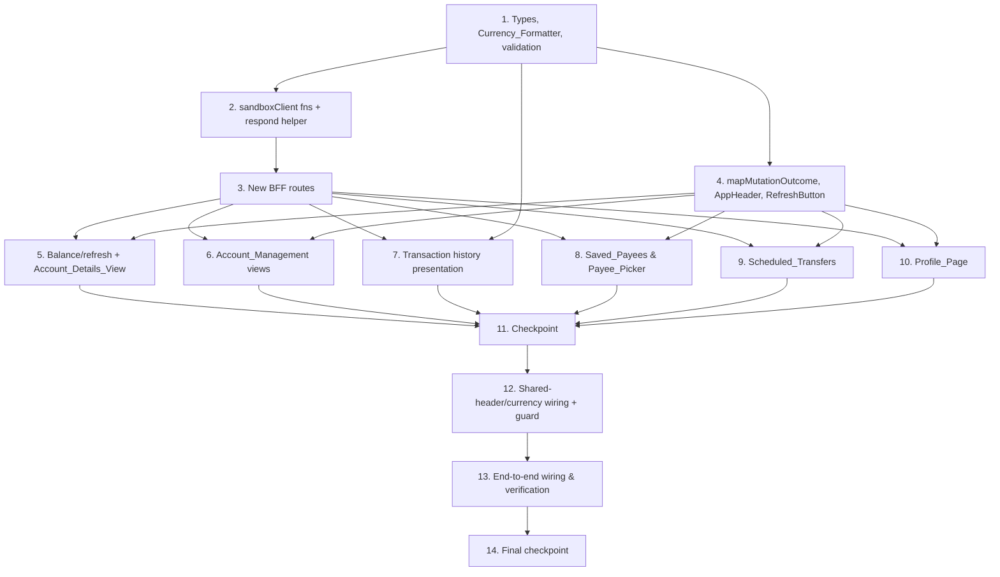

# Implementation Plan: Banking App Realism

## Overview

This plan implements the **client-side realism layer** on top of the existing v1 Banking_App (`customer-banking-app`): a dedicated account details view, account open/close, saved payees, scheduled and recurring transfers, a profile page, correct balance/statement freshness with manual refresh, a shared navigation header, and a shared currency formatter. It reuses the v1 architecture without exception — the browser never holds the access token or Sandbox_Key, every new data need is served by a new same-origin `/api/bff/*` route, and every new route flows through the single `lib/server/sandboxClient.ts` choke point and the shared `app/api/bff/_lib/respond.ts` helpers.

Work proceeds bottom-up and each step ends integrated, mirroring the v1 plan: (1) shared domain types, the extracted `Currency_Formatter`, and extended pure validation are established first; (2) the new `sandboxClient` functions (wire↔domain mappers + `deps` seam) and the `respondFromMutationResult` helper; (3) the new BFF routes; (4) the `mapMutationOutcome` mapper, the shared `AppHeader`, and the `RefreshButton`; (5) the feature views in priority order — balance/refresh wiring (Req 1) and Account_Details_View (Req 2) first, then Account_Management (Req 3), transaction-history presentation (Req 4), Saved_Payees (Req 5), Scheduled_Transfers (Req 6), Profile_Page (Req 7); (6) cross-cutting shared-header/currency wiring (Req 8) and the Property 5 static-guard extension; and (7) end-to-end wiring and full verification.

Tests are written alongside each unit. Property-based tests (Vitest + fast-check, ≥ 100 iterations, tagged `Feature: banking-app-realism, Property {N}: ...`) cover the security-, mapping-, validation-, and fidelity-critical paths (Properties 1–11); example/integration tests (Vitest + React Testing Library + MSW) cover per-view loading/empty/error states and flow behavior. No test issues a request to the live Sandbox_Gateway, and the suite does not depend on the backend repository.

## Tasks

- [x] 1. Shared foundations: domain types, Currency_Formatter, and extended validation
  - [x] 1.1 Add the new domain types to `lib/types.ts`
    - Define `OpenAccountRequest` (`type: AccountType`, `currency: string`), `Payee` (`id`, `label`, `destinationAccount`), and `CreatePayeeRequest` (`label`, `destinationAccount`)
    - Define `Recurrence` (`'ONCE' | 'DAILY' | 'WEEKLY' | 'MONTHLY'`), `ScheduledTransferStatus` (`'SCHEDULED' | 'EXECUTED' | 'FAILED' | 'CANCELLED'`), `ScheduledTransfer` (incl. `scheduleDate`, `recurrence`, `status`, optional `lastOutcome: TransferOutcomeInput`), and `ScheduledTransferRequest`
    - Define `CustomerProfileUpdate` as a `Partial<Pick<CustomerProfile, ...>>` over the editable fields
    - Keep the module server+client safe with no secrets; reuse the existing `AccountType`, `CustomerProfile`, and `TransferOutcomeInput` types as the single source of truth
    - _Requirements: 3.1, 5.1, 6.1, 6.5, 6.7, 7.8_

  - [x] 1.2 Extract the shared `Currency_Formatter` into `lib/currency.ts`
    - Create `lib/currency.ts` exporting `AMOUNT_PLACEHOLDER` and a pure, framework-free `formatCurrency(amount, currency)` that uses a FIXED locale (never the host locale) for character-for-character stable output
    - Return the fixed placeholder for null/undefined/non-finite amounts without throwing; render the numeric amount with an empty/non-ISO-4217 code shown verbatim without throwing
    - Replace the duplicated inline `formatCurrency` in `app/dashboard/DashboardClient.tsx` and `app/accounts/[accountNumber]/StatementClient.tsx` with imports of the shared utility
    - _Requirements: 8.4, 8.5, 8.6, 8.7, 8.8_

  - [ ]* 1.3 Write property test for Currency_Formatter determinism and totality
    - **Property 6: Currency_Formatter determinism and totality**
    - **Validates: Requirements 8.6, 8.7, 8.8**
    - Generate arbitrary finite/non-finite amounts and valid/invalid currency codes; assert character-identical output across invocations and re-run under different host locales, fixed placeholder for bad amounts, verbatim code for bad currency, never throws
    - Tag: `Feature: banking-app-realism, Property 6: Currency_Formatter determinism and totality`; ≥ 100 iterations
    - _Requirements: 8.6, 8.7, 8.8 ; Properties: P6_

  - [x] 1.4 Extend pure validation in `lib/transferValidation.ts`
    - Add `PayeeFormValues` / `PayeeFormErrors` and `validatePayeeForm` (non-empty label, non-empty destination account per 5.2/5.13)
    - Add `ScheduledTransferFormValues` / `ScheduledTransferFormErrors` and `validateScheduledTransferForm(values, now, ownedAccounts?)` reusing `validateTransferForm` for the money fields and requiring `scheduleDate` strictly after `now`
    - Keep the exported rules framework-free so the BFF routes can re-apply them server-side for parity
    - _Requirements: 5.2, 5.13, 6.2, 6.3_

  - [ ]* 1.5 Write unit tests for the extended validation rules
    - Assert `validatePayeeForm` flags empty label and empty destination account; assert `validateScheduledTransferForm` reuses transfer-field rules and rejects a schedule date not strictly after `now`
    - _Requirements: 5.2, 5.13, 6.2, 6.3_

- [x] 2. New `sandboxClient` functions and the mutation respond helper
  - [x] 2.1 Add the account-management and profile `sandboxClient` functions
    - In `lib/server/sandboxClient.ts`, implement `createAccount(body, deps?)` (`POST /accounts` ASSUMED), `closeAccount(accountNumber, deps?)` (`POST /accounts/{n}/close` ASSUMED), and `updateCustomer(body, deps?)` (`PATCH /customers/me` ASSUMED)
    - Route each through `sandboxFetch`, encode path segments with `encodeURIComponent`, thread `deps` through for testability, and reuse `mapAccount` / `mapCustomer` defensive mappers
    - _Requirements: 3.1, 3.5, 7.8, 9.1_

  - [x] 2.2 Add the saved-payee and scheduled-transfer `sandboxClient` functions and their mappers
    - Implement `listPayees` / `createPayee` / `deletePayee` (`GET/POST /payees`, `DELETE /payees/{id}` ASSUMED) and `listScheduledTransfers` / `createScheduledTransfer` / `cancelScheduledTransfer` (`GET/POST /payments/scheduled-transfers`, `POST .../{id}/cancel` ASSUMED)
    - Add defensive `mapPayee` and `mapScheduledTransfer` wire↔domain mappers that tolerate missing/renamed fields (`payeeId`/`id`, `scheduledTransferRef`/`id`) and never throw; project the executed outcome onto `TransferOutcomeInput` for `lastOutcome`
    - Return the existing `SandboxResult<T>` union; thread `deps` and `encodeURIComponent` path segments
    - _Requirements: 5.1, 5.4, 5.7, 6.1, 6.5, 6.6, 9.1_

  - [x] 2.3 Add the `respondFromMutationResult` helper to `app/api/bff/_lib/respond.ts`
    - Add `respondFromMutationResult(result, { createdStatus })` as a thin wrapper over the existing mapping so 201/202 success is forwarded distinctly while reusing the existing 401/403/409/429/timeout/network/unexpected branches
    - Forward only `status` + `error` (plus the non-secret `message` for a forwarded 409); reuse `requireSession` / `errorResponse` / `respondFromResult` / `respondFromTransferResult` unchanged
    - _Requirements: 9.2, 9.4, 9.7_

  - [ ]* 2.4 Write property test for credential confinement on the new sandboxClient paths
    - **Property 7: Credential confinement for the new BFF routes**
    - **Validates: Requirements 9.2, 9.3, 9.4, 9.5, 9.7**
    - Drive each new function with fake `deps` (token/config/fetch) over arbitrary upstream statuses and `Error_Body` payloads; assert no token/key/raw-upstream-header ever appears in the result, and the missing-credential path issues no outbound call
    - Tag: `Feature: banking-app-realism, Property 7: Credential confinement for the new BFF routes`; ≥ 100 iterations
    - _Requirements: 9.2, 9.3, 9.4, 9.5, 9.7 ; Properties: P7_

  - [ ]* 2.5 Write property test for header injection and client-header ignore on the new paths
    - **Property 8: Header injection and client-header ignore on the new routes**
    - **Validates: Requirements 9.1, 9.6**
    - Over arbitrary methods and arbitrary client-supplied `Authorization` / `X-Sandbox-Key` headers, assert the outbound (mocked) request carries the server-side credentials (and `Content-Type: application/json` for bodied requests), never the client-supplied values
    - Tag: `Feature: banking-app-realism, Property 8: Header injection and client-header ignore on the new routes`; ≥ 100 iterations
    - _Requirements: 9.1, 9.6 ; Properties: P8_

- [x] 3. New BFF route handlers
  - [x] 3.1 Implement the Account_Management BFF routes
    - Add `POST` to `app/api/bff/accounts/route.ts` (validate `{ type, currency }` server-side, then `createAccount` → `respondFromMutationResult`)
    - Create `app/api/bff/accounts/[accountNumber]/close/route.ts` `POST` (`closeAccount` → `respondFromMutationResult`, surfacing 409 business conflict)
    - Each handler sets `dynamic = 'force-dynamic'`, `runtime = 'nodejs'`, calls `requireSession()` first, and forwards only `status` + `error` (+ non-secret 409 `message`)
    - _Requirements: 3.1, 3.2, 3.5, 3.8, 3.9, 3.10, 3.11, 9.1, 9.2_

  - [x] 3.2 Implement the Saved_Payee BFF routes
    - Create `app/api/bff/payees/route.ts` `GET` (list → `respondFromResult`) and `POST` (re-apply `validatePayeeForm` server-side → `createPayee` → `respondFromMutationResult`)
    - Create `app/api/bff/payees/[payeeId]/route.ts` `DELETE` (`deletePayee` → `respondFromMutationResult`)
    - `requireSession()` first on each; forward only `status` + `error`
    - _Requirements: 5.1, 5.2, 5.4, 5.7, 5.11, 5.12, 9.1, 9.2_

  - [x] 3.3 Implement the Scheduled_Transfer BFF routes
    - Create `app/api/bff/scheduled-transfers/route.ts` `GET` (list → `respondFromResult`) and `POST` (re-apply `validateScheduledTransferForm` incl. strictly-after-today server-side → `createScheduledTransfer` → `respondFromMutationResult`)
    - Create `app/api/bff/scheduled-transfers/[id]/cancel/route.ts` `POST` (`cancelScheduledTransfer` → `respondFromMutationResult`, surfacing 409)
    - For executed-outcome fidelity, map any executed `lastOutcome` through `respondFromTransferResult` so AML held/blocked forward identically to the Transfer_Form
    - _Requirements: 6.1, 6.2, 6.3, 6.5, 6.6, 6.7, 6.10, 6.11, 6.12, 6.13, 9.1, 9.2_

  - [x] 3.4 Implement the profile-update BFF route
    - Add `PATCH` to `app/api/bff/customer/route.ts` (validate editable fields server-side → `updateCustomer` → `respondFromMutationResult`); leave the existing `GET` unchanged for reuse by the Profile_Page
    - `requireSession()` first; forward only `status` + `error`
    - _Requirements: 7.8, 7.9, 7.13, 9.1, 9.2_

  - [ ]* 3.5 Write property test for client/server validation parity
    - **Property 3: Validation soundness and client/server parity**
    - **Validates: Requirements 3.2, 4.5, 4.6, 5.2, 5.13, 6.2, 6.3, 7.9, 12.6**
    - Generate arbitrary payee and scheduled-transfer inputs; assert the pure `transferValidation` verdict equals the BFF route's server-side verdict (identical accept/reject), and invalid → no outbound call
    - Tag: `Feature: banking-app-realism, Property 3: Validation soundness and client/server parity`; ≥ 100 iterations
    - _Requirements: 3.2, 5.2, 5.13, 6.2, 6.3, 7.9, 12.6 ; Properties: P3_

  - [ ]* 3.6 Write integration tests for the new BFF routes with mocked sandbox
    - Assert each route requires a session; assert one test per status among 201/202, 403, 409, 401, 429 (and timeout/network) maps to a distinct forwarded `status` + `error`; assert no token/key appears in any response
    - _Requirements: 3.8, 3.9, 3.10, 3.11, 3.12, 5.11, 5.12, 6.11, 6.12, 6.13, 9.4, 12.3, 12.4_

- [x] 4. Mutation outcome mapper, AppHeader, and RefreshButton
  - [x] 4.1 Implement the `mapMutationOutcome` mapper beside `mapTransferOutcome`
    - Add a pure, total `mapMutationOutcome(input)` in `lib/transferPresentation.ts` (or a sibling module) mapping 201/202 → success, 403 → not-authorized, 409 → conflict (message from `error` code), 401 → re-auth, 429 → rate-limit (no auto-retry < 60 s), and every other status/timeout/network → generic retryable error
    - Reuse `mapTransferOutcome` unchanged for executed scheduled-transfer outcomes so there is a single transfer-outcome source of truth
    - _Requirements: 3.8, 3.9, 3.10, 3.11, 3.12, 5.10, 5.11, 5.12, 6.10, 6.11, 6.12, 6.13, 7.11, 7.12, 10.5, 10.6_

  - [ ]* 4.2 Write property test for mutation outcome determinism and totality
    - **Property 4: Mutation outcome determinism and totality**
    - **Validates: Requirements 3.8, 3.9, 3.10, 3.11, 3.12, 5.11, 5.12, 6.10, 6.11, 6.12, 6.13, 10.6**
    - Generate arbitrary HTTP statuses; assert exactly one outcome state, covered statuses mutually exclusive, every uncovered status/transport failure → generic retryable error
    - Tag: `Feature: banking-app-realism, Property 4: Mutation outcome determinism and totality`; ≥ 100 iterations
    - _Requirements: 3.8, 3.9, 3.10, 3.11, 3.12, 5.11, 5.12, 6.10, 6.11, 6.12, 6.13, 10.6 ; Properties: P4_

  - [ ]* 4.3 Write property test for executed-transfer outcome reuse
    - **Property 5: Executed-transfer outcome reuse**
    - **Validates: Requirements 6.7**
    - Generate arbitrary executed-outcome inputs; assert the scheduled view's presentation equals `mapTransferOutcome(input)` including AML held/blocked
    - Tag: `Feature: banking-app-realism, Property 5: Executed-transfer outcome reuse`; ≥ 100 iterations
    - _Requirements: 6.7 ; Properties: P5_

  - [x] 4.4 Implement the shared `AppHeader` component
    - Create `app/components/AppHeader.tsx` (client component) with navigation links to Dashboard, Statement_View, Account_Details_View, Transfer_Form, Profile_Page, Account_Management, and Scheduled_Transfer views, plus the existing `LogoutButton`, and an `active` prop for `aria-current`
    - _Requirements: 8.1, 8.3_

  - [x] 4.5 Implement the shared `RefreshButton` (Manual_Refresh) with a single-flight guard
    - Create `app/components/RefreshButton.tsx` that re-invokes a supplied region loader, disables itself while a refresh is in flight so at most one outbound refresh is issued per cycle, shows a loading state within 300 ms, and on failure/>10 s retains prior data and re-enables
    - _Requirements: 1.4, 1.5, 1.6, 1.7, 1.8_

  - [ ]* 4.6 Write property test for the Manual_Refresh single-flight guard
    - **Property 11: Manual_Refresh single-flight guard**
    - **Validates: Requirements 1.6**
    - Drive the refresh guard through arbitrary activation sequences; assert at most one outbound refresh per completed cycle
    - Tag: `Feature: banking-app-realism, Property 11: Manual_Refresh single-flight guard`; ≥ 100 iterations
    - _Requirements: 1.6 ; Properties: P11_

- [x] 5. Balance/refresh wiring (Req 1) and Account_Details_View (Req 2)
  - [x] 5.1 Wire Manual_Refresh into the Dashboard and Statement_View
    - Render `RefreshButton` on `DashboardClient` and `StatementClient`, re-invoking the existing region loaders without a full page reload; keep each region's `refreshing` flag distinct from initial `loading`, replace data on success, and retain prior data with an error+retry on failure/timeout
    - Confirm displayed balances/transactions equal exactly the latest successful BFF response with no client-side adjustment
    - _Requirements: 1.1, 1.2, 1.3, 1.4, 1.5, 1.6, 1.7, 1.8_

  - [ ]* 5.2 Write property test for read fidelity
    - **Property 1: Read fidelity (display equals the latest response, no client adjustment)**
    - **Validates: Requirements 1.2, 1.3**
    - Generate arbitrary accounts and transactions responses; assert rendered balances/rows correspond one-to-one to the latest response with no derived/adjusted/synthesized value after load or refresh
    - Tag: `Feature: banking-app-realism, Property 1: Read fidelity`; ≥ 100 iterations
    - _Requirements: 1.2, 1.3 ; Properties: P1_

  - [x] 5.3 Implement the Account_Details_View page and client
    - Create `app/accounts/[accountNumber]/details/page.tsx` and `AccountDetailsClient.tsx` fetching `GET /api/bff/accounts/[accountNumber]` and rendering number, type, Account_Status, currency, and `Currency_Formatter` balance **read-only** with no mutating control
    - Handle loading (within 300 ms), empty (no account), 403 not-owner distinct state, 401 re-auth, 429 rate-limit, and generic error+retry; render `AppHeader`
    - _Requirements: 2.1, 2.2, 2.3, 2.4, 2.5, 2.6, 2.7, 2.8, 2.9_

  - [ ]* 5.4 Write integration tests for the Account_Details_View states
    - Assert success, empty, not-owner (403), 401 re-auth, 429 rate-limit, and error/timeout+retry states using mocked BFF responses
    - _Requirements: 2.3, 2.4, 2.5, 2.6, 2.7, 2.9_

- [x] 6. Account_Management views (Req 3)
  - [x] 6.1 Implement the OpenAccountForm and open-account page
    - Create `app/accounts/open/page.tsx` and `OpenAccountForm.tsx` with type + currency fields, client validation per 3.2 (missing/unaccepted type, missing currency → field error, no request), submit to `POST /api/bff/accounts`, success outcome per 3.3, and 403/401/429/generic outcome mapping via `mapMutationOutcome`; render `AppHeader`
    - _Requirements: 3.1, 3.2, 3.3, 3.8, 3.10, 3.11, 3.12_

  - [x] 6.2 Implement the CloseAccountButton with confirmation
    - Create `CloseAccountButton.tsx` requiring explicit confirmation before any BFF call (no request before confirm; no request on cancel); on confirm, `POST /api/bff/accounts/[accountNumber]/close` and map 403/409-by-error-code/401/429/generic outcomes; wire into the Account_Details_View / Dashboard
    - _Requirements: 3.4, 3.5, 3.6, 3.7, 3.8, 3.9, 3.10, 3.11, 3.12_

  - [ ]* 6.3 Write integration tests for Account_Management flows
    - Assert open-account valid submit → POST and field-error-no-request; assert close confirmation gate (no request before confirm, none on cancel) and distinct 403/409/401/429/generic outcome states
    - _Requirements: 3.2, 3.3, 3.4, 3.7, 3.8, 3.9, 12.3_

- [x] 7. Transaction history presentation improvements (Req 4)
  - [x] 7.1 Enhance the Statement_View transaction presentation
    - Update `StatementClient` to render each transaction's direction as debit/credit per the data, render the counterparty only when present (omit without error otherwise), and render the running balance only when present; retain the existing date-range filter (`from <= to`, invalid-range error with no request and retained data) and forward valid ISO-8601 params
    - Use the shared `Currency_Formatter` for all amounts
    - _Requirements: 4.1, 4.2, 4.3, 4.4, 4.5, 4.6, 4.7, 4.8, 4.9, 4.10_

  - [ ]* 7.2 Write property test for transaction presentation fidelity
    - **Property 2: Transaction presentation fidelity**
    - **Validates: Requirements 4.1, 4.2, 4.3**
    - Generate arbitrary transactions; assert direction matches, counterparty rendered iff present (otherwise omitted without error), running balance rendered iff present
    - Tag: `Feature: banking-app-realism, Property 2: Transaction presentation fidelity`; ≥ 100 iterations
    - _Requirements: 4.1, 4.2, 4.3 ; Properties: P2_

  - [ ]* 7.3 Write integration tests for transaction presentation and date-range behavior
    - Assert debit/credit rendering, counterparty present/absent, running-balance present/absent, empty-range, invalid-range (no request + retained data), and error/timeout states
    - _Requirements: 4.2, 4.3, 4.6, 4.9, 4.10_

- [x] 8. Saved_Payees and the Payee_Picker (Req 5)
  - [x] 8.1 Implement the PayeePicker and payee management surface
    - Create `PayeePicker.tsx` fetching `GET /api/bff/payees`, displaying each payee's label + destination account, with loading (within 300 ms)/empty/error+retry, 401 re-auth, and 429 rate-limit states; add a create surface (`validatePayeeForm` → `POST /api/bff/payees`, success per 5.3) and a delete control (`DELETE /api/bff/payees/[payeeId]` → remove on success)
    - Wire the picker into the Transfer_Form so selecting a payee populates the "To account" field; render `AppHeader`
    - _Requirements: 5.1, 5.2, 5.3, 5.4, 5.5, 5.6, 5.7, 5.8, 5.9, 5.10, 5.11, 5.12, 5.13_

  - [ ]* 8.2 Write property test for payee selection populating the destination account
    - **Property 10: Payee selection populates the destination account**
    - **Validates: Requirements 5.6**
    - Generate arbitrary payees; assert selecting one sets the Transfer_Form "To account" to exactly that payee's destination account
    - Tag: `Feature: banking-app-realism, Property 10: Payee selection populates the destination account`; ≥ 100 iterations
    - _Requirements: 5.6 ; Properties: P10_

  - [ ]* 8.3 Write integration tests for payee create/select/delete and states
    - Assert create valid→POST and field-error-no-request, select populates To-account, delete removes on success, and loading/empty/error/401/429 states
    - _Requirements: 5.2, 5.3, 5.5, 5.7, 5.8, 5.9, 5.10, 5.11, 5.12, 12.3_

- [x] 9. Scheduled_Transfers (Req 6)
  - [x] 9.1 Implement the Scheduled_Transfer create/list/cancel views
    - Create `app/scheduled-transfers/page.tsx` plus a `ScheduledTransfer` create form (source/destination/amount/description via `transferValidation`, schedule date strictly after today, recurrence select incl. one-off) submitting to `POST /api/bff/scheduled-transfers`
    - Render a list showing each transfer's Scheduled_Transfer_Status (`GET /api/bff/scheduled-transfers`) with loading (within 300 ms)/empty/error+retry, a cancel control for SCHEDULED items (`POST .../[id]/cancel`, 409 handling), and executed-outcome rendering reusing the Transfer_Form outcome mapping; render `AppHeader`
    - _Requirements: 6.1, 6.2, 6.3, 6.4, 6.5, 6.6, 6.7, 6.8, 6.9, 6.10, 6.11, 6.12, 6.13_

  - [ ]* 9.2 Write integration tests for Scheduled_Transfer flows and executed-outcome rendering
    - Assert create valid→POST and schedule-date/field-error-no-request, list with statuses, cancel of a SCHEDULED item (and 409 when already executed/cancelled), empty/error/401/429 states, and executed held/blocked rendering matching the Transfer_Form
    - _Requirements: 6.3, 6.4, 6.5, 6.6, 6.7, 6.8, 6.9, 6.10, 6.11, 6.12, 12.3_

- [x] 10. Profile_Page (Req 7)
  - [x] 10.1 Implement the Profile_Page and ProfileClient
    - Create `app/profile/page.tsx` and `ProfileClient.tsx` fetching `GET /api/bff/customer`, rendering the returned fields with loading (within 300 ms)/empty/error+retry, 401 re-auth, and 429 rate-limit states
    - Where edits are supported, validate each editable field client-side before `PATCH /api/bff/customer` (field error → no request) and show success/updated or error-retaining outcomes; otherwise render read-only with no edit control; render `AppHeader`
    - _Requirements: 7.1, 7.2, 7.3, 7.4, 7.5, 7.6, 7.7, 7.8, 7.9, 7.10, 7.11, 7.12, 7.13_

  - [ ]* 10.2 Write integration tests for the Profile_Page states and update flow
    - Assert success, empty, error/timeout+retry, 401 re-auth, 429 rate-limit, read-only vs editable rendering, update success-updated, and update error-retaining states using mocked responses
    - _Requirements: 7.2, 7.3, 7.4, 7.5, 7.6, 7.7, 7.9, 7.11, 7.12, 12.3_

- [x] 11. Checkpoint - Ensure all tests pass
  - Ensure all tests pass, ask the user if questions arise.

- [x] 12. Cross-cutting shared-header/currency wiring and the direct-call guard (Req 8)
  - [x] 12.1 Render AppHeader across all authenticated pages and confirm shared currency usage
    - Render `AppHeader` on the Dashboard, Statement_View, Transfer_Form, and every new view (replacing ad-hoc inline navigation/`LogoutButton` usage), and confirm every displayed amount routes through the shared `Currency_Formatter` rather than an inline `Intl` call
    - _Requirements: 8.1, 8.2, 8.3, 8.5, 8.9_

  - [ ]* 12.2 Extend the Property 5 static guard to include the new views
    - **Property 9: No direct browser-to-gateway calls for the new views**
    - **Validates: Requirements 8.9, 11.2, 12.5**
    - Extend `app/__guards__/no-direct-gateway-calls.test.ts` so the new client views appear in the discovered set and every fetch target is a `/api/bff/*` path with no gateway/issuer host literal
    - Tag: `Feature: banking-app-realism, Property 9: No direct browser-to-gateway calls for the new views`; ≥ 100 iterations
    - _Requirements: 8.9, 11.2, 12.5 ; Properties: P9_

- [x] 13. End-to-end wiring and verification
  - [x] 13.1 Wire navigation across all views and verify the full suite
    - Connect `AppHeader` navigation across all authenticated views, confirm every new view behaves against mocked sandbox responses, and confirm no browser-facing response from any new route exposes the access token or Sandbox_Key
    - Run the full lint, type-check, build, and test suite and resolve any failures
    - _Requirements: 8.2, 11.1, 11.2, 12.1, 12.4, 12.5_

  - [ ]* 13.2 Write end-to-end mocked-sandbox verification tests
    - Confirm Properties P1–P11 hold across the wired application and that every new Sandbox_Gateway-dependent view asserts its loading/empty/error states with no live network request
    - _Requirements: 12.1, 12.2, 12.4, 12.5 ; Properties: P1, P2, P3, P4, P5, P6, P7, P8, P9, P10, P11_

- [x] 14. Final checkpoint - Ensure all tests pass
  - Ensure all tests pass, ask the user if questions arise.

## Task Dependencies



## Notes

- Tasks marked with `*` are optional test sub-tasks and can be skipped for a faster MVP; core implementation tasks are never optional. The implementer MUST implement non-`*` sub-tasks and MUST NOT implement `*` sub-tasks unless asked.
- Each leaf task references specific requirement sub-clauses for traceability; security-, mapping-, validation-, and fidelity-critical tasks also reference the design's correctness properties (P1–P11).
- Test approach: Vitest + React Testing Library with all sandbox interactions mocked via MSW (and `fetch`/`deps` fakes for server-side helpers). Property-based tests use fast-check at a minimum of 100 iterations and are tagged `Feature: banking-app-realism, Property {number}: {property_text}`. No test issues a request to the live Sandbox_Gateway (Requirement 12.1).
- Sequencing rationale: shared types + `Currency_Formatter` + extended validation come first; the new `sandboxClient` functions and the `respondFromMutationResult` helper precede the new BFF routes; the `mapMutationOutcome` mapper, `AppHeader`, and `RefreshButton` precede the feature views so each view reuses them; the feature views follow the requested priority order (Req 1/2 → 3 → 4 → 5 → 6 → 7); the cross-cutting shared-header/currency wiring and the Property 5 guard extension, then end-to-end verification, come last.
- Security posture is inherited, not reimplemented: every new route calls `requireSession()` first, flows through `sandboxClient`/`sandboxFetch` for server-side `Authorization` + `X-Sandbox-Key` injection, and forwards only `status` + `error` (+ non-secret 409 `message`) via the `respond.ts` helpers. The browser never holds the access token or Sandbox_Key.
- ASSUMED upstream paths (`POST /accounts`, `POST /accounts/{n}/close`, `GET/POST /payees`, `DELETE /payees/{id}`, `GET/POST /payments/scheduled-transfers`, `POST .../{id}/cancel`, `PATCH /customers/me`) are reached only through their `sandboxClient` function, so confirming or correcting a path against the backend contract is a one-line change that leaves routes, views, validation, and tests unaffected. Views degrade gracefully where an endpoint does not yet exist.
- Freshness: the backend outbox/propagation mechanism is out of scope; the client only displays exactly what the latest successful read returned and provides Manual_Refresh to re-fetch after propagation.

## Task Dependency Graph

```json
{
  "waves": [
    { "id": 0, "tasks": ["1.1", "1.2"] },
    { "id": 1, "tasks": ["1.3", "1.4", "4.4", "4.5"] },
    { "id": 2, "tasks": ["1.5", "2.1", "2.2", "2.3", "4.1", "4.6"] },
    { "id": 3, "tasks": ["2.4", "2.5", "3.1", "3.2", "3.3", "3.4", "4.2", "4.3"] },
    { "id": 4, "tasks": ["3.5", "3.6", "5.1", "5.3", "6.1", "6.2", "7.1", "8.1", "9.1", "10.1"] },
    { "id": 5, "tasks": ["5.2", "5.4", "6.3", "7.2", "7.3", "8.2", "8.3", "9.2", "10.2"] },
    { "id": 6, "tasks": ["12.1"] },
    { "id": 7, "tasks": ["12.2", "13.1"] },
    { "id": 8, "tasks": ["13.2"] }
  ]
}
```
