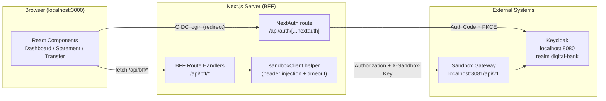

# Design Document

## Overview

The Banking_App is a customer-facing digital banking web application built with **Next.js 14+ (App Router, TypeScript)**. It is a pure HTTP client of the independently deployed RP Digital Bank Sandbox: it implements no banking business logic of its own and holds no ledger state. Every piece of banking data (customer profile, accounts, transactions, transfer outcomes) originates from the Sandbox_Gateway and is only presented by this application.

The application runs locally on **TCP port 3000**, which is the port registered as an allowed web origin and redirect host on the Keycloak `sandbox-web` client. Running on this port is a hard requirement so that OIDC redirects and CORS succeed with no extra sandbox configuration (per `INTEGRATION_WITH_BANK.md` sections 2 and 9, and Requirement 10).

### Security posture: Backend-for-Frontend (BFF)

The central design decision is that **the browser never possesses the OIDC access token or the sandbox API key**. The sandbox requires two secrets on every protected call — an `Authorization: Bearer <access_token>` header and an `X-Sandbox-Key` header — and neither may be exposed to client-side JavaScript.

To enforce this, all outbound calls to the Sandbox_Gateway are made from **Next.js server-side route handlers** that act as a Backend-for-Frontend (BFF). The browser calls same-origin BFF endpoints under `/api/bff/*`; the BFF reads the access token from the server-side session and the API key from a server-only environment variable, attaches both to the upstream request, and returns only sanitized data and status/error codes to the browser. The access token and API key therefore never cross the network boundary to the client in any header, body, cookie, or other payload.

### Scope

In scope: OIDC login/logout, an account dashboard, an account statement view with an optional date-range filter, a money-transfer form with full client-side validation and outcome-specific result states, the BFF proxy layer, environment-driven configuration, resilience (loading/empty/error states, timeouts, graceful degradation), repository setup, CI, and a test suite driven by mocked sandbox responses.

Out of scope: any banking business logic (balances, AML rules, ledger posting, ownership enforcement) — all of that is owned by the sandbox. A known v1 caveat is that the sandbox's account service is not synchronized with the payment ledger, so a dashboard balance may lag a just-completed transfer; the UI tolerates this rather than trying to reconcile it.

## Architecture

### Layered request flow

```
Browser (React Server + Client Components)
    │  (same-origin fetch to /api/bff/*, cookie-based session)
    ▼
Next.js Route Handlers  ── the BFF proxy layer (server-only)
    │  reads access token from server session + X-Sandbox-Key from env
    │  injects Authorization + X-Sandbox-Key + Content-Type
    │  applies timeout (AbortController), normalizes errors
    ▼
Sandbox Gateway  http://localhost:8081/api/v1
    │  routes to customer / account / transaction / payment services
    ▼
RP Digital Bank Sandbox (external, independent)
```



### Authentication: NextAuth (Auth.js) with the Keycloak provider

Authentication uses **NextAuth (Auth.js) configured with its Keycloak/OIDC provider**, using the **Authorization Code flow with PKCE** against issuer `http://localhost:8080/realms/digital-bank` and public client `sandbox-web`.

**Why NextAuth rather than a browser-only library (keycloak-js / oidc-client-ts).** A browser-only OIDC library stores the access token in the browser (memory, `localStorage`, or a readable context), which directly contradicts the BFF security posture: the token would be available to client-side JavaScript. NextAuth instead performs the code exchange on the server and persists the resulting tokens inside an **encrypted, HTTP-only session cookie / server-side JWT**, so the browser holds only an opaque session reference, never the raw access token. The BFF then reads the access token server-side (via the NextAuth `jwt` callback and `getServerSession` / `auth()`), where it is attached to outbound sandbox calls. This makes NextAuth the natural fit for a token-confinement design.

Session handling:
- The `jwt` callback stores the Keycloak `access_token` (and `expires_at`) on the server-side token object.
- A `session` callback deliberately exposes only non-sensitive fields (e.g. the customer display name / `customer_ref` claim) to the client — never the access token.
- Sessions expire **24 hours** after establishment (Requirement 1.7); after that the user is treated as unauthenticated.
- Login timeout: if authorization is not completed within **300 seconds**, the flow is aborted and the user is returned to an unauthenticated state with a timeout message (Requirement 1.2).

### Configuration (environment-driven)

All endpoints and secrets come from environment variables; no literal URLs or keys appear in source (Requirement 7.5). Variables are split into **server-only** (no `NEXT_PUBLIC_` prefix, never bundled into client JS) and **public**.

| Variable | Scope | Purpose | Local default |
|----------|-------|---------|---------------|
| `NEXTAUTH_URL` | server | Canonical app URL / OIDC redirect base | `http://localhost:3000` |
| `NEXT_PUBLIC_APP_URL` | public | App URL available to client (display/links only) | `http://localhost:3000` |
| `NEXTAUTH_SECRET` | server | Session/JWT encryption secret | (required, no default) |
| `KEYCLOAK_ISSUER` | server | OIDC issuer | `http://localhost:8080/realms/digital-bank` |
| `KEYCLOAK_CLIENT_ID` | server | OIDC client id | `sandbox-web` |
| `SANDBOX_API_BASE_URL` | server | Sandbox gateway base path | `http://localhost:8081/api/v1` |
| `SANDBOX_API_KEY` | **server only** | `X-Sandbox-Key` value | `demo-key-123` |

`SANDBOX_API_KEY` and the access token are strictly server-only and must never be given a `NEXT_PUBLIC_` prefix; doing so would inline them into the client bundle and defeat the BFF posture. Startup performs **fail-fast validation** (Requirement 7.6, 7.7): if any required variable is missing/empty, or any of the URL-valued variables is malformed, the app aborts startup and reports every offending variable by name.

### BFF proxy pattern

A single shared server-side helper — `sandboxClient` — centralizes all upstream calls. It:

1. Resolves the access token from the current server session and the API key from `SANDBOX_API_KEY`.
2. Refuses to issue the request (returns an `UNAUTHENTICATED` result) if either credential is missing (Requirement 6.5).
3. Injects `Authorization: Bearer <token>`, `X-Sandbox-Key: <key>`, and (for bodies) `Content-Type: application/json`.
4. Sends the request from origin `http://localhost:3000` (Requirement 10.5).
5. Applies a per-call **timeout via `AbortController`** (10 s for data reads per Requirement 6.1/6.6; 30 s for transfers per Requirement 4.10; a 15 s view-level cap per Requirement 8.3 is enforced at the calling boundary).
6. Normalizes upstream responses and the sandbox `Error_Body` into a typed result, stripping anything secret before anything is returned to the browser (Requirement 6.7).

Each BFF route handler is a thin wrapper that calls one `sandboxClient` function and shapes the HTTP response for the browser.

## Components and Interfaces

### Authentication components

- **NextAuth route handler** — `app/api/auth/[...nextauth]/route.ts`. Exports the `GET`/`POST` handlers produced by NextAuth, configured with the Keycloak provider (`issuer` = `KEYCLOAK_ISSUER`, `clientId` = `KEYCLOAK_CLIENT_ID`, PKCE enabled), `session.maxAge = 24h`, and `jwt`/`session` callbacks as described above.
- **Middleware** — `middleware.ts`. Protects `/dashboard`, `/accounts/*`, and `/transfer`; any request without a valid session is redirected to `/login` without exposing protected data (Requirement 1.6).
- **Login/logout UI entry points** — `/login` page with a "Sign in" action invoking `signIn('keycloak')`; a logout control invoking `signOut()` which clears the local session and redirects to the login entry point (Requirement 1.5). The redirect URI used is `http://localhost:3000/...`, matching the registered `sandbox-web` redirect (Requirement 10.3, 10.4).

### BFF route handlers (1:1 with sandbox endpoints)

Each handler is server-only, requires a valid session, and delegates to `sandboxClient`.

| BFF route (browser calls this) | Upstream sandbox call | Notes |
|--------------------------------|-----------------------|-------|
| `GET /api/bff/customer` | `GET /customers/me` | Signed-in customer profile |
| `GET /api/bff/accounts` | `GET /accounts` | Owned accounts list |
| `GET /api/bff/accounts/[accountNumber]` | `GET /accounts/{accountNumber}` | One owned account (404 if not owned) |
| `GET /api/bff/accounts/[accountNumber]/transactions` | `GET /transactions/accounts/{accountNumber}` | Optional `from`/`to` ISO-8601 query params forwarded |
| `POST /api/bff/transfers` | `POST /payments/transfers` | JSON body `{fromAccount,toAccount,amount,description}` |

The transactions handler forwards `from`/`to` only when present and only after the calling layer has validated `from <= to` (Requirement 3.3/3.4).

### Server-side `sandboxClient` helper

Located at `lib/server/sandboxClient.ts` (server-only module). Illustrative TypeScript signatures:

```typescript
interface RequestOptions {
  timeoutMs?: number;        // default 10_000; transfers use 30_000
  signal?: AbortSignal;
}

// Internal: resolves credentials, injects headers, applies timeout, normalizes errors.
async function sandboxFetch<T>(
  path: string,
  init: RequestInit,
  opts?: RequestOptions
): Promise<SandboxResult<T>>;

async function getCustomer(): Promise<SandboxResult<Customer>>;
async function listAccounts(): Promise<SandboxResult<Account[]>>;
async function getAccount(accountNumber: string): Promise<SandboxResult<Account>>;
async function getTransactions(
  accountNumber: string,
  range?: { from?: string; to?: string }    // ISO 8601
): Promise<SandboxResult<Transaction[]>>;
async function createTransfer(body: TransferRequest): Promise<TransferResult>;
```

Header-injection and timeout sketch (secrets resolved server-side only):

```typescript
async function sandboxFetch<T>(path, init, opts = {}) {
  const token = await getAccessTokenFromSession(); // server session
  const apiKey = process.env.SANDBOX_API_KEY;
  if (!token || !apiKey) return { kind: 'UNAUTHENTICATED' };

  const controller = new AbortController();
  const timer = setTimeout(() => controller.abort(), opts.timeoutMs ?? 10_000);
  try {
    const res = await fetch(`${process.env.SANDBOX_API_BASE_URL}${path}`, {
      ...init,
      headers: {
        ...init.headers,
        Authorization: `Bearer ${token}`,
        'X-Sandbox-Key': apiKey,
        'Content-Type': 'application/json',
      },
      signal: controller.signal,
    });
    return normalize<T>(res); // maps status + ErrorBody to a typed result; never includes secrets
  } catch (e) {
    return { kind: 'ERROR', reason: isAbortError(e) ? 'TIMEOUT' : 'NETWORK' };
  } finally {
    clearTimeout(timer);
  }
}
```

### UI pages and components (App Router)

- **`/login`** — unauthenticated entry point; "Sign in with the bank" action.
- **`/dashboard`** — lists the signed-in customer identity and their accounts (number + currency-formatted balance). Fetches `/api/bff/customer` and `/api/bff/accounts` independently so a partial failure degrades per-region (Requirement 2.7).
- **`/accounts/[accountNumber]`** — Statement_View: account details plus transactions, with a date-range filter form (`from`/`to`). Client validation blocks `from > to` without sending a request and retains previously loaded transactions (Requirement 3.4).
- **`/transfer`** — Transfer_Form with fields `fromAccount`, `toAccount`, `amount`, `description`; full client-side validation (Requirement 5); submit disabled while in flight (Requirement 4.2); a shared **result banner** renders the outcome-specific state.

**Shared state components** (per Requirement 8.6 each data-dependent view has distinct states):
- `LoadingState` — shown within 300 ms of initiating a request (and within 500 ms for the statement list).
- `EmptyState` — for empty accounts / empty transaction ranges.
- `ErrorState` — error message plus a **retry action** that re-initiates the failed request.
- `TransferResultBanner` — a discriminated rendering over the `TransferResult` union so each outcome (completed / held / blocked / conflict / forbidden / rate-limited / error) is visually distinct.

### Client-side data fetching

Client components fetch same-origin BFF endpoints (`fetch('/api/bff/...')`), never the gateway. Each fetch tracks `loading` / `data` / `error`, enforces a view-level timeout, renders the appropriate shared state, and surfaces a retry action on failure. A 401 from the BFF triggers re-authentication (routes the user back to login).

## Data Models

TypeScript types live in `lib/types.ts` (safe for both server and client; contains no secrets).

```typescript
// --- Customer ---
interface Customer {
  customerRef: string;   // e.g. "CUST-ALICE"
  name: string;          // display name, e.g. "Alice"
  email?: string;
}

// --- Account ---
type AccountType = 'SAVINGS' | 'CURRENT';

interface Account {
  accountNumber: string; // e.g. "ACC-1001"
  type: AccountType;     // "SAVINGS" | "CURRENT"
  balance: number;       // e.g. 5000.00
  currency: string;      // e.g. "SGD"
}

// --- Transaction ---
type TransactionDirection = 'CREDIT' | 'DEBIT';

interface Transaction {
  id: string;
  timestamp: string;            // ISO 8601
  amount: number;               // absolute value
  direction: TransactionDirection; // sign of the movement
  description: string;
  counterparty?: string;        // other account, when available
  runningBalance?: number;      // balance after the entry, when available
}

// --- Transfer request (body sent to POST /payments/transfers) ---
interface TransferRequest {
  fromAccount: string;   // e.g. "ACC-1001"
  toAccount: string;     // e.g. "ACC-1002"
  amount: number;        // 0.01 .. 999,999,999.99, max 2 decimals
  description: string;   // 0..140 chars
}

// --- Sandbox error body (section 5 of the integration contract) ---
interface ErrorBody {
  timestamp: string;
  status: number;
  error: string;    // machine-readable code, e.g. "INSUFFICIENT_FUNDS"
  message: string;
  path: string;
}

// --- Transfer result: discriminated union keyed by outcome ---
type TransferResult =
  | { kind: 'COMPLETED';      status: 201 }                         // success
  | { kind: 'AML_HELD';       status: 202 }                         // held for review
  | { kind: 'AML_BLOCKED';    status: 422 }                         // blocked
  | { kind: 'CONFLICT';       status: 409; error: string; message: string } // INSUFFICIENT_FUNDS | SAME_ACCOUNT | CURRENCY_MISMATCH | INVALID_AMOUNT
  | { kind: 'FORBIDDEN';      status: 403 }                         // not owner of source account
  | { kind: 'UNAUTHENTICATED';status: 401 }                         // re-authenticate
  | { kind: 'RATE_LIMITED';   status: 429 }                         // rate limited, retry after delay
  | { kind: 'ERROR';          reason: 'NETWORK' | 'TIMEOUT' | 'UNEXPECTED'; status?: number };

// --- Generic result for read endpoints ---
type SandboxResult<T> =
  | { kind: 'OK'; data: T }
  | { kind: 'UNAUTHENTICATED' }
  | { kind: 'RATE_LIMITED' }
  | { kind: 'ERROR'; reason: 'NETWORK' | 'TIMEOUT' | 'UNEXPECTED' | 'HTTP'; status?: number; error?: string };
```

**Realistic example (seeded data).** For `alice` (`CUST-ALICE`): `{ accountNumber: "ACC-1001", type: "SAVINGS", balance: 5000.00, currency: "SGD" }` and `{ accountNumber: "ACC-1002", type: "CURRENT", balance: 1200.50, currency: "SGD" }`. A transfer body: `{ fromAccount: "ACC-1001", toAccount: "ACC-1002", amount: 100.00, description: "pocket money" }`.

## Error Handling

### Transfer outcome mapping

Every transfer response maps to exactly one `TransferResult` variant and one distinct UI state:

| HTTP status | `TransferResult.kind` | UI state (result banner) | Requirement |
|-------------|------------------------|--------------------------|-------------|
| 201 | `COMPLETED` | Success — transfer completed (distinct from all others) | 4.3 |
| 202 | `AML_HELD` | Held for AML review | 4.4 |
| 422 | `AML_BLOCKED` | Blocked by AML controls | 4.5 |
| 409 | `CONFLICT` | Business conflict; message reflects `error` code | 4.6 |
| 403 | `FORBIDDEN` | Not the owner of the source account | 4.7 |
| 401 | `UNAUTHENTICATED` | Treat as unauthenticated → route to re-authentication | 4.8 |
| 429 | `RATE_LIMITED` | Rate-limited; allow retry after a short delay, no auto-retry | 4.9 |
| unreachable / >30 s / any other status | `ERROR` | Generic error + retry; **retain entered form values** | 4.10 |

For 409, the `error` code from the `Error_Body` drives the message: `INSUFFICIENT_FUNDS`, `SAME_ACCOUNT`, `CURRENCY_MISMATCH`, or `INVALID_AMOUNT` each render a specific human-readable explanation.

### Read-endpoint error handling (Dashboard / Statement)

- **Loading**: a loading state is shown within 300 ms of initiating a request (Requirement 8.1); the statement list shows its loading state within 500 ms (Requirement 3.6).
- **Empty**: a successful response with no data renders an empty state (Requirements 2.5, 3.7, 8.5).
- **Timeout**: reads are cancelled via `AbortController`; the view-level cap is 15 s (Requirement 8.3), with the data regions themselves expecting completion within 10 s (Requirements 2.6, 3.8).
- **Partial failure** (Dashboard): the profile and accounts requests are independent, so one may succeed and render while the other shows an error + retry for just its region (Requirement 2.7).
- **Network / connectivity error**: a connectivity message plus a retry action that re-initiates the request (Requirement 8.2); previously loaded data is retained and navigation to other views stays available (Requirement 8.4).
- **429**: a rate-limit message with no automatic retry before a delay (Requirement 8.7).

### 401 and re-authentication

Any 401 from the BFF (expired/invalid token or session) causes the Banking_App to treat the customer as unauthenticated and route them to re-authentication (Requirements 1.7, 4.8).

### BFF normalization and secret confinement

The BFF converts the upstream response — including the sandbox `Error_Body` — into a typed result and forwards only `status` and the `error` code to the browser so the UI can present an outcome-specific message. It never includes the access token or `Sandbox_Key` in any response header, body, or cookie (Requirements 6.2, 6.3, 6.6, 6.7). If credentials are missing server-side, the BFF returns an "unauthenticated" response without issuing the upstream call (Requirement 6.5). A CORS origin-denied response from the gateway fails the request with an origin-not-permitted message (Requirement 10.6).

### v1 synchronization caveat

Per `INTEGRATION_WITH_BANK.md` section 8, the payment service owns its own ledger and the account service is not synchronized with completed transfers in v1. The Dashboard therefore may display balances that do not yet reflect a just-completed transfer; this is expected behavior and the UI does not attempt to reconcile it (Requirement 2.9).

## Testing Strategy

Tests use **Vitest + React Testing Library**, with all sandbox interactions **mocked via MSW (Mock Service Worker)** (or `fetch` mocks for unit-level helpers). No test issues a network request to the live Sandbox_Gateway (Requirement 11.1). This is example/integration-based rather than property-based for most UI behavior, complemented by invariant checks for the security- and mapping-critical paths (see Correctness Properties).

### Unit and integration test cases

- **Transfer outcomes** — one test per status (201, 202, 422, 409, 403, 401, 429, and network/timeout/unexpected error), each supplying the mocked response and asserting a distinct, observable `TransferResult` / banner state (Requirement 11.2). The 409 tests cover each `error` code.
- **Per-view states** — for Dashboard and Statement_View, assert the loading, empty, and error states, where the error state has an observable, user-visible indication and a retry action (Requirement 11.3). Includes the Dashboard partial-failure case.
- **Transfer form validation** — assert field-level errors and that no request is sent for: empty `fromAccount`, empty `toAccount`, equal source/destination, `amount` outside 0.01–999,999,999.99 / non-numeric / >2 decimals, and `description` over 140 chars (Requirement 11.4).
- **BFF header injection** — assert that outbound (mocked) requests carry `Authorization: Bearer <token>` and `X-Sandbox-Key`.
- **Secret confinement** — assert the access token and API key never appear in any browser-facing response (headers, body, cookies) from any BFF route.
- **Config validation** — assert fail-fast startup when a required env var is missing/empty or a URL is malformed.

### Continuous Integration

A GitHub Actions workflow runs, as ordered distinct steps (Requirement 9.4): **install → lint → type-check → build**, with tests run as part of the pipeline. Any failing step stops the pipeline and reports failure (Requirement 9.5). The pipeline uses only this repository's sources and does not depend on the sandbox repository (Requirement 9.6).

## Correctness Properties

*A property is a characteristic or behavior that should hold true across all valid executions of a system — essentially, a formal statement about what the system should do. Properties serve as the bridge between human-readable specifications and machine-verifiable correctness guarantees.*

These properties target the security-, mapping-, and validation-critical logic of the BFF and the client. Each is implemented as a single property-based test configured for a minimum of 100 iterations, tagged with the format **Feature: customer-banking-app, Property {number}: {property_text}**. Pure UI-state and flow behaviors are covered by example/integration tests in the Testing Strategy instead.

### Property 1: Credential confinement

*For any* BFF route and *for any* upstream sandbox outcome (success, any error status, or a normalized `Error_Body`), the response the BFF returns to the Browser_Client — across its headers, body, and cookies — SHALL NOT contain the access token value or the Sandbox_Key value; and when either credential is absent server-side, the BFF SHALL return an unauthenticated response without issuing the outbound request.

**Validates: Requirements 6.2, 6.3, 6.5, 6.6, 6.7**

### Property 2: Header injection on every outbound call

*For any* BFF route and method, the outbound request issued to the Sandbox_Gateway SHALL carry an `Authorization: Bearer <access_token>` header and an `X-Sandbox-Key` header (and `Content-Type: application/json` for requests with a body).

**Validates: Requirements 6.1, 6.4**

### Property 3: Transfer outcome determinism

*For any* HTTP status returned by the Sandbox_Gateway for a transfer, the outcome mapper SHALL produce exactly one `TransferResult` variant (and one corresponding UI state), the mapping SHALL be mutually exclusive across the covered statuses 201/202/422/409/403/401/429, and every status not explicitly covered SHALL map to the `ERROR` variant.

**Validates: Requirements 4.3, 4.4, 4.5, 4.6, 4.7, 4.8, 4.9, 4.10**

### Property 4: Validation soundness

*For any* Transfer_Form input or date-range input that violates a validation rule — empty source or destination account, equal source and destination, amount that is empty / ≤ 0 / > 999,999,999.99 / non-numeric / with more than two decimal places, description longer than 140 characters, or a date range where `from` is later than `to` — the Banking_App SHALL NOT send a request to the BFF and SHALL surface a field-level error; and *for any* input satisfying all rules, the request SHALL be sent.

**Validates: Requirements 3.3, 3.4, 5.1, 5.2, 5.3, 5.4, 5.5, 5.6**

### Property 5: No direct browser-to-gateway calls

*For any* data need in the Browser_Client, the request target SHALL be a same-origin `/api/bff/*` endpoint and SHALL NEVER be the Sandbox_Gateway origin directly.

**Validates: Requirements 6.4, 10.5**

### Property 6: Config integrity (fail-fast)

*For any* Environment_Config in which a required variable is missing or an empty string, or in which the Sandbox_Gateway base URL, Identity_Provider issuer URL, or application URL is not a well-formed URL, the Banking_App SHALL abort startup without serving requests and SHALL report every offending variable by name.

**Validates: Requirements 7.6, 7.7**

### Property 7: Idempotent submit guard

*For any* sequence of submit interactions issued while a Transfer request is already in flight, the Transfer_Form SHALL keep the submit control disabled such that at most one outbound `POST /payments/transfers` is issued per completed request cycle.

**Validates: Requirements 4.2**
