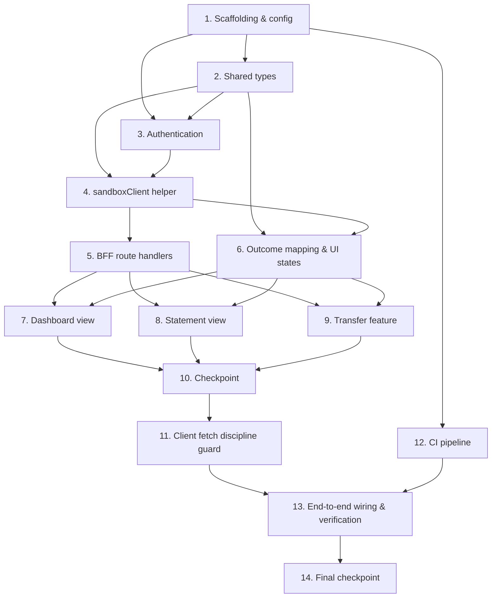

# Implementation Plan: Customer Banking App

## Overview

This plan implements the Banking_App as a Next.js 14+ (App Router, TypeScript) client of the RP Digital Bank Sandbox. Work proceeds bottom-up: project scaffolding, environment config, and shared types are established first; then the server-side security layer (NextAuth session + `sandboxClient` with header injection and timeouts); then the BFF route handlers that confine credentials server-side; then the outcome mapper and shared UI state components; then the three feature views (Dashboard, Statement, Transfer); and finally the client-fetch discipline guard, CI pipeline, and end-to-end wiring/verification.

Each step builds on the previous one and ends integrated — there is no orphaned code. Tests are written alongside each unit. Property-based tests (Vitest + fast-check) cover the security-, mapping-, and validation-critical paths (Properties 1–7); example/integration tests (Vitest + React Testing Library + MSW) cover UI state and flow behavior. No test issues a request to the live Sandbox_Gateway.

## Tasks

- [x] 1. Project scaffolding, repository setup, and environment configuration
  - [x] 1.1 Initialize the Next.js 14+ App Router TypeScript project
    - Scaffold the project (App Router, TypeScript, ESLint) with pinned dependency versions in `package.json`
    - Add scripts: `dev` (bound to port 3000), `lint`, `type-check` (tsc --noEmit), `build`, `test`
    - Add the testing toolchain as dev dependencies: Vitest, React Testing Library, MSW, and fast-check
    - Create base `tsconfig.json`, ESLint config, and Vitest config
    - _Requirements: 10.1, 10.2_

  - [x] 1.2 Add repository setup artifacts
    - Create `.gitignore` excluding at minimum `node_modules`, build output (`.next`), and `.env.local`
    - Create `.env.local.example` documenting every required variable with placeholder values: `NEXTAUTH_URL`, `NEXT_PUBLIC_APP_URL`, `NEXTAUTH_SECRET`, `KEYCLOAK_ISSUER`, `KEYCLOAK_CLIENT_ID`, `SANDBOX_API_BASE_URL`, `SANDBOX_API_KEY`
    - Create `README` documenting the required Node.js version, a step-ordered instruction to start the sandbox before the Banking_App, and how to run on port 3000
    - _Requirements: 9.1, 9.2, 9.3_

  - [x] 1.3 Implement the fail-fast environment configuration module
    - Create a server-only config module that reads all Environment_Config values, applies the documented local defaults (sandbox base URL, issuer, client id, app URL, sandbox key), and exposes a typed accessor
    - On startup, validate that every required variable is present and non-empty; if any are missing/empty, abort startup without serving requests and report every offending variable by name
    - Validate that the sandbox base URL, issuer URL, and application URL are well-formed; if any is malformed, abort startup and report the malformed value by name
    - Ensure `SANDBOX_API_KEY` and session secret are never given a `NEXT_PUBLIC_` prefix and remain server-only
    - Assert no literal gateway/issuer URLs or key values appear in application source (values come only from config)
    - _Requirements: 7.1, 7.2, 7.3, 7.4, 7.5, 7.6, 7.7_

  - [x]* 1.4 Write property test for config integrity (fail-fast)
    - **Property 6: Config integrity (fail-fast)** — for any config missing/empty required vars or with a malformed URL, startup aborts and reports every offending variable by name; valid config starts cleanly
    - **Validates: Requirements 7.6, 7.7**
    - _Requirements: 7.6, 7.7 ; Properties: P6_

- [x] 2. Implement shared data model types
  - [x] 2.1 Create `lib/types.ts`
    - Define `Customer`, `Account` (+ `AccountType`), `Transaction` (+ `TransactionDirection`), `TransferRequest`, and `ErrorBody`
    - Define the `TransferResult` discriminated union (COMPLETED/AML_HELD/AML_BLOCKED/CONFLICT/FORBIDDEN/UNAUTHENTICATED/RATE_LIMITED/ERROR) and the generic `SandboxResult<T>` union
    - Ensure the module is safe for both server and client and contains no secrets
    - _Requirements: 2.3, 3.5, 4.1_

- [x] 3. Authentication with NextAuth and the Keycloak provider
  - [x] 3.1 Configure the NextAuth route handler and session callbacks
    - Create `app/api/auth/[...nextauth]/route.ts` with the Keycloak provider using issuer `KEYCLOAK_ISSUER` and client `KEYCLOAK_CLIENT_ID`, Authorization Code flow with PKCE enabled
    - Implement the `jwt` callback to store the Keycloak `access_token` and `expires_at` server-side; implement the `session` callback to expose only non-sensitive fields (never the access token)
    - Set session `maxAge` to 24 hours so sessions expire 24h after establishment and subsequent requests are treated as unauthenticated
    - Handle the 300-second login timeout: abort the flow, return to an unauthenticated state, discard partial credentials, and surface a timeout message
    - Handle failed/cancelled auth or a code exchange that yields no valid Access_Token: return to unauthenticated state without a session, discard partial credentials, and surface a login-failed message
    - Use a redirect URI with scheme `http`, host `localhost`, port 3000 matching the registered `sandbox-web` client; surface an error if the redirect URI is not authorized
    - _Requirements: 1.1, 1.2, 1.3, 1.4, 1.7, 10.3, 10.4_

  - [x] 3.2 Implement route-protection middleware and login/logout entry points
    - Create `middleware.ts` protecting `/dashboard`, `/accounts/*`, and `/transfer`; redirect any request without a valid session to `/login` without exposing protected data
    - Create the `/login` page with a "Sign in" action invoking `signIn('keycloak')`
    - Implement a logout control invoking `signOut()` that clears the local session, invalidates the token for the app, and redirects to the login entry point
    - _Requirements: 1.5, 1.6_

  - [x]* 3.3 Write unit tests for auth session exposure and route protection
    - Assert the session callback never exposes the access token to the client
    - Assert middleware redirects unauthenticated requests for protected views to `/login`
    - _Requirements: 1.5, 1.6_

- [x] 4. Server-side `sandboxClient` helper
  - [x] 4.1 Implement `sandboxFetch` with credential injection, timeouts, and normalization
    - Create `lib/server/sandboxClient.ts` (server-only); resolve the access token from the server session and the API key from `SANDBOX_API_KEY`
    - If either credential is missing, return an `UNAUTHENTICATED` result without issuing the outbound request
    - Inject `Authorization: Bearer <token>`, `X-Sandbox-Key: <key>`, and `Content-Type: application/json` for bodies; send from origin `http://localhost:3000`
    - Apply per-call timeouts via `AbortController` (default 10s for reads, 30s for transfers); map abort to a `TIMEOUT` error and connectivity failures to `NETWORK`
    - Normalize upstream responses and the sandbox `Error_Body` into the typed result, stripping any secret before returning
    - Fail a CORS origin-denied response with an origin-not-permitted outcome
    - _Requirements: 6.1, 6.5, 6.6, 6.7, 8.3, 10.5, 10.6_

  - [x] 4.2 Implement the typed sandbox functions
    - Implement `getCustomer`, `listAccounts`, `getAccount`, `getTransactions` (forwarding optional `from`/`to` ISO-8601 params), and `createTransfer` on top of `sandboxFetch`
    - _Requirements: 6.1, 2.1, 2.2, 3.1, 3.2, 4.1_

  - [x]* 4.3 Write property test for credential confinement
    - **Property 1: Credential confinement** — for any upstream outcome, the returned result never contains the access token or Sandbox_Key across headers/body/cookies; missing credentials yield an unauthenticated result with no outbound request
    - **Validates: Requirements 6.2, 6.3, 6.5, 6.6, 6.7**
    - _Requirements: 6.2, 6.3, 6.5, 6.6, 6.7 ; Properties: P1_

  - [x]* 4.4 Write property test for header injection on every outbound call
    - **Property 2: Header injection on every outbound call** — for any path/method, the outbound (mocked) request carries `Authorization: Bearer <token>` and `X-Sandbox-Key` (and `Content-Type: application/json` for bodies)
    - **Validates: Requirements 6.1, 6.4**
    - _Requirements: 6.1, 6.4 ; Properties: P2_

  - [x]* 4.5 Write unit tests for timeout/abort and error normalization
    - Assert reads abort at 10s and transfers at 30s, mapping to `TIMEOUT`; assert `Error_Body` normalization preserves `status` and `error` code only
    - _Requirements: 6.6, 6.7, 8.3_

- [x] 5. BFF route handlers (1:1 with sandbox endpoints)
  - [x] 5.1 Implement the read-endpoint BFF handlers
    - Create `GET /api/bff/customer`, `GET /api/bff/accounts`, `GET /api/bff/accounts/[accountNumber]`, and `GET /api/bff/accounts/[accountNumber]/transactions`
    - Each handler requires a valid session, delegates to the matching `sandboxClient` function, and forwards only `status` + `error` code to the browser
    - The transactions handler forwards `from`/`to` only when both are present and after `from <= to` has been validated upstream
    - _Requirements: 2.1, 2.2, 3.1, 3.2, 3.3, 6.7_

  - [x] 5.2 Implement the transfer BFF handler
    - Create `POST /api/bff/transfers` requiring a valid session; forward the JSON body `{fromAccount,toAccount,amount,description}` to `createTransfer`
    - Return the mapped outcome's status + error code only, never any secret
    - _Requirements: 4.1, 6.7_

  - [x]* 5.3 Write property test for secret confinement across BFF routes
    - **Property 1: Credential confinement** — for any BFF route and any upstream outcome, no browser-facing response (headers/body/cookies) contains the access token or Sandbox_Key
    - **Validates: Requirements 6.2, 6.3, 6.7**
    - _Requirements: 6.2, 6.3, 6.7 ; Properties: P1_

  - [x]* 5.4 Write integration tests for BFF routes with mocked sandbox
    - Assert each route requires a session, forwards query params correctly (transactions `from`/`to`), and surfaces normalized status/error codes
    - _Requirements: 2.1, 2.2, 3.1, 3.2, 3.3, 4.1_

- [x] 6. Outcome mapping and shared UI state components
  - [x] 6.1 Implement the transfer outcome mapper
    - Map HTTP status to exactly one `TransferResult` variant: 201→COMPLETED, 202→AML_HELD, 422→AML_BLOCKED, 409→CONFLICT (message from `error` code), 403→FORBIDDEN, 401→UNAUTHENTICATED, 429→RATE_LIMITED, and any other status / unreachable / >30s → ERROR
    - Ensure the mapping is total and mutually exclusive across covered statuses
    - _Requirements: 4.3, 4.4, 4.5, 4.6, 4.7, 4.8, 4.9, 4.10_

  - [x] 6.2 Implement the shared UI state components
    - Build `LoadingState` (shown within 300ms of initiating a request), `EmptyState`, and `ErrorState` (message + retry action that re-initiates the request)
    - Build `TransferResultBanner` rendering a visually distinct state per `TransferResult` variant, including a rate-limit message with no automatic retry before a delay
    - Ensure each data-dependent view can present distinct loading, empty, and error states
    - _Requirements: 8.1, 8.2, 8.4, 8.5, 8.6, 8.7_

  - [x]* 6.3 Write property test for transfer outcome determinism
    - **Property 3: Transfer outcome determinism** — for any HTTP status, the mapper yields exactly one variant; covered statuses (201/202/422/409/403/401/429) are mutually exclusive; every uncovered status maps to ERROR
    - **Validates: Requirements 4.3, 4.4, 4.5, 4.6, 4.7, 4.8, 4.9, 4.10**
    - _Requirements: 4.3, 4.4, 4.5, 4.6, 4.7, 4.8, 4.9, 4.10 ; Properties: P3_

  - [x]* 6.4 Write unit tests for the shared state components
    - Assert loading/empty/error rendering and that the error state exposes a working retry action; assert 429 shows a rate-limit message with no auto-retry
    - _Requirements: 8.1, 8.2, 8.4, 8.5, 8.6, 8.7_

- [x] 7. Dashboard view
  - [x] 7.1 Implement the `/dashboard` page
    - Fetch `/api/bff/customer` and `/api/bff/accounts` independently so a partial failure degrades per region
    - Render the customer identity and the list of accounts with currency-formatted balances; show a loading state while requests are in progress
    - Render an empty state when accounts is empty; render an error state with retry for a failed region while showing successful data for the other
    - Continue running without crashing when the gateway is unreachable/errors; route to re-authentication on a 401
    - Tolerate the v1 balance-lag caveat (no reconciliation of just-completed transfers)
    - _Requirements: 2.1, 2.2, 2.3, 2.4, 2.5, 2.6, 2.7, 2.8, 2.9_

  - [x]* 7.2 Write integration tests for the Dashboard
    - Assert success, empty-accounts, full-error, and partial-failure (one region ok, one errored with retry) states using mocked BFF responses
    - _Requirements: 2.3, 2.4, 2.5, 2.6, 2.7, 2.8_

- [x] 8. Statement view
  - [x] 8.1 Implement the `/accounts/[accountNumber]` page
    - Fetch account details and transactions through the BFF; show a loading state within 500ms until data resolves or fails
    - Provide a date-range filter (`from`/`to`); when `from <= to`, forward the values as ISO-8601 query params
    - When `from > to`, show a validation error, do not send the request, and retain previously loaded transactions
    - Render account details + transactions on success within 10s; show an empty state for a zero-transaction range; show an error state with retry on failure/timeout while continuing to run
    - _Requirements: 3.1, 3.2, 3.3, 3.4, 3.5, 3.6, 3.7, 3.8_

  - [-]* 8.2 Write integration tests for the Statement view
    - Assert success, empty-range, invalid-range (no request sent + retained data), and error/timeout states using mocked BFF responses
    - _Requirements: 3.4, 3.5, 3.6, 3.7, 3.8_

- [x] 9. Transfer feature
  - [x] 9.1 Implement the Transfer_Form with full client-side validation
    - Build `/transfer` with fields `fromAccount`, `toAccount`, `amount`, `description`
    - Validate: non-empty source account, non-empty destination account, source != destination, amount in 0.01–999,999,999.99 with at most two decimals and numeric, description 0–140 chars; on any violation show a field-level error and do not send the request
    - _Requirements: 5.1, 5.2, 5.3, 5.4, 5.5, 5.6_

  - [x] 9.2 Implement transfer submission and outcome rendering
    - On a valid submission, `POST /api/bff/transfers` with the JSON body; disable the submit control while in flight to prevent duplicate submission
    - Render each outcome via `TransferResultBanner` (201/202/422/409-by-error-code/403/429); on 401 route to re-authentication
    - On a generic/unexpected error or >30s, show the generic error state with retry and retain the entered form values; continue running without crashing
    - _Requirements: 4.1, 4.2, 4.3, 4.4, 4.5, 4.6, 4.7, 4.8, 4.9, 4.10_

  - [-]* 9.3 Write property test for validation soundness
    - **Property 4: Validation soundness** — for any input violating a transfer-form or date-range rule, no request is sent and a field-level error is shown; for any fully valid input, the request is sent
    - **Validates: Requirements 3.3, 3.4, 5.1, 5.2, 5.3, 5.4, 5.5, 5.6**
    - _Requirements: 3.3, 3.4, 5.1, 5.2, 5.3, 5.4, 5.5, 5.6 ; Properties: P4_

  - [-]* 9.4 Write property test for the idempotent submit guard
    - **Property 7: Idempotent submit guard** — for any sequence of submit interactions while a request is in flight, at most one `POST /api/bff/transfers` is issued per completed request cycle
    - **Validates: Requirements 4.2**
    - _Requirements: 4.2 ; Properties: P7_

  - [-]* 9.5 Write integration tests for transfer outcomes
    - Assert each mocked status (201/202/422/409 per error code/403/401/429/network/timeout/unexpected) renders a distinct banner state; assert values retained on generic error
    - _Requirements: 4.3, 4.4, 4.5, 4.6, 4.7, 4.8, 4.9, 4.10_

- [~] 10. Checkpoint - Ensure all tests pass
  - Ensure all tests pass, ask the user if questions arise.

- [ ] 11. Client fetch discipline and direct-call guard
  - [~] 11.1 Enforce browser-to-BFF-only data access
    - Ensure every client component fetches same-origin `/api/bff/*` endpoints and never the gateway origin; route a BFF 401 to re-authentication
    - _Requirements: 6.4, 10.5_

  - [ ]* 11.2 Add a test/lint guard asserting no direct browser-to-gateway calls
    - **Property 5: No direct browser-to-gateway calls** — for any client data need, the request target is a same-origin `/api/bff/*` endpoint and never the Sandbox_Gateway origin
    - **Validates: Requirements 6.4, 10.5**
    - _Requirements: 6.4, 10.5 ; Properties: P5_

- [x] 12. Continuous integration pipeline
  - [x] 12.1 Add the GitHub Actions CI workflow
    - Define distinct ordered steps: install → lint → type-check → build, with tests run as part of the pipeline
    - Ensure any failing step stops the pipeline and reports failure; ensure the pipeline uses only this repository's sources and does not depend on the sandbox repository
    - _Requirements: 9.4, 9.5, 9.6_

- [ ] 13. End-to-end wiring and verification
  - [~] 13.1 Wire navigation and verify the full test suite
    - Connect navigation across login, dashboard, statement, and transfer views
    - Confirm all views behave correctly against mocked sandbox responses and that no browser-facing response exposes the access token or Sandbox_Key
    - Run the full lint, type-check, build, and test suite and resolve any failures
    - _Requirements: 11.1, 11.2, 11.3, 11.4_

  - [ ]* 13.2 Write end-to-end mocked-sandbox verification tests
    - Confirm Properties P1–P7 hold across the wired application and that every Sandbox_Gateway-dependent view asserts its loading/empty/error states with no live network request
    - _Requirements: 11.1, 11.2, 11.3, 11.4 ; Properties: P1, P2, P3, P4, P5, P6, P7_

- [~] 14. Final checkpoint - Ensure all tests pass
  - Ensure all tests pass, ask the user if questions arise.

## Task Dependencies



## Notes

- Tasks marked with `*` are optional test sub-tasks and can be skipped for a faster MVP; core implementation tasks are never optional. The implementer MUST implement non-`*` sub-tasks and MUST NOT implement `*` sub-tasks unless asked.
- Each leaf task references specific requirement sub-clauses for traceability; security-, mapping-, and validation-critical tasks also reference the design's correctness properties (P1–P7).
- Test approach: Vitest + React Testing Library with all sandbox interactions mocked via MSW (and `fetch` mocks for server-side helpers). Property-based tests use fast-check at a minimum of 100 iterations and are tagged `Feature: customer-banking-app, Property {number}: {property_text}`. No test issues a request to the live Sandbox_Gateway (Requirement 11.1).
- Sequencing rationale: scaffolding, config, and shared types come first; the authentication session and `sandboxClient` (token + API key confinement) precede the BFF handlers; the outcome mapper and shared UI state components precede the three views so each view reuses them; the client-fetch guard, CI, and end-to-end verification come last.
- Port 3000 is a hard requirement: the app must bind to TCP 3000 so OIDC redirects and CORS succeed against the registered `sandbox-web` client with no extra sandbox configuration (Requirements 10.1–10.5).
- v1 balance-lag caveat: the sandbox account service is not synchronized with the payment ledger, so the Dashboard may show balances that do not yet reflect a just-completed transfer. This is expected; the UI tolerates it and does not attempt reconciliation (Requirement 2.9).

## Task Dependency Graph

```json
{
  "waves": [
    { "id": 0, "tasks": ["1.1", "1.2"] },
    { "id": 1, "tasks": ["1.3", "2.1", "12.1"] },
    { "id": 2, "tasks": ["1.4", "3.1"] },
    { "id": 3, "tasks": ["3.2", "3.3", "4.1"] },
    { "id": 4, "tasks": ["4.2", "4.3", "4.4", "4.5", "6.1", "6.2"] },
    { "id": 5, "tasks": ["5.1", "5.2", "6.3", "6.4"] },
    { "id": 6, "tasks": ["5.3", "5.4", "7.1", "8.1", "9.1"] },
    { "id": 7, "tasks": ["7.2", "8.2", "9.2"] },
    { "id": 8, "tasks": ["9.3", "9.4", "9.5", "11.1"] },
    { "id": 9, "tasks": ["11.2", "13.1"] },
    { "id": 10, "tasks": ["13.2"] }
  ]
}
```
